# Nodus — Comprehensive Project Report

**Project:** Nodus — Hybrid, Offline-First Peer-to-Peer Storage System  
**Repository:** `nodus` monorepo  
**Document type:** Full technical report (architecture, system design, working, data model, security, deployment, testing)  
**Generated:** 2026-10-22  
**Primary sources:** `README.md`, `nodus_implementation_plan.md`, `docs/`, SQLite migrations, and the implementation in `apps/`, `packages/`, and `services/`.

> **How to use this document.** Sections 1–5 are suitable for an introduction and
> system overview in a written report or presentation. Sections 6–11 are the
> technical core. Sections 12–14 cover operations, validation, and limitations.
> The appendices contain API, configuration, and protocol reference tables that
> can be lifted directly into slides or an appendix.

---

## Table of Contents

1. [Executive Summary](#1-executive-summary)
2. [Introduction](#2-introduction)
3. [Feature Overview](#3-feature-overview)
4. [Technology Stack and Repository Structure](#4-technology-stack-and-repository-structure)
5. [System Architecture](#5-system-architecture)
6. [Component Deep Dive](#6-component-deep-dive)
7. [Data Model and Database Design](#7-data-model-and-database-design)
8. [Security and Cryptography](#8-security-and-cryptography)
9. [Protocol Design](#9-protocol-design)
10. [Working: End-to-End Flows](#10-working-end-to-end-flows)
11. [State Machines](#11-state-machines)
12. [Deployment and Operations](#12-deployment-and-operations)
13. [Testing and Validation](#13-testing-and-validation)
14. [Current Status, Limitations, and Future Work](#14-current-status-limitations-and-future-work)
15. [Glossary](#15-glossary)
16. [References](#16-references)
- [Appendix A — Relay HTTP API](#appendix-a--relay-http-api)
- [Appendix B — Storage Node Local HTTP API](#appendix-b--storage-node-local-http-api)
- [Appendix C — WebSocket and Event Reference](#appendix-c--websocket-and-event-reference)
- [Appendix D — Configuration Reference](#appendix-d--configuration-reference)
- [Appendix E — Presentation Notes](#appendix-e--presentation-notes)

---

## 1. Executive Summary

Nodus is a **hybrid, offline-first, peer-to-peer storage system**. Unlike
conventional cloud storage, it does not treat a central server or the Internet as
the source of truth. Files live primarily on a **Storage Node** that the user
owns and controls. Devices synchronize directly with that node over the local
network whenever possible. The Internet is used as an **enhancement** — for
remote access, signaling, and temporary buffering — never as a hard dependency.

The system is built from four deployable components:

| Component | Implementation | Primary role |
|---|---|---|
| **Web client** | Next.js 16 + React 19 + Tailwind v4 | Browser UI, session-cookie auth, local encrypted catalog, upload/download |
| **Mobile client** | React Native / Expo (CNG native build) | Native iOS/Android client with mDNS, WebRTC, SQLite, background drain |
| **Relay** | Go 1.27, SQLite, Redis | Control plane: accounts, sessions, devices, nodes, catalog replica, signaling, pairing, temporary encrypted buffer, Relay rebuild |
| **Storage Node** | Rust (edition 2024), SQLite, content-addressed object store | Data plane: durable storage, sync journal, WebRTC serving, reconciliation, GC |

The core design principle is:

> **The Internet is an enhancement, not a dependency.**

Nodus achieves this through four ideas:

1. **Local-network-first operation.** A client that is on the same Wi-Fi/LAN as
   its Storage Node can authenticate with it using Ed25519 challenge-response and
   transfer files directly, with no Relay involvement.
2. **Encrypted sharding with client-held keys.** Files are split into shards
   (typically 8 MB), each encrypted with AES-256-GCM using a per-file key. The
   Relay and Storage Node only ever see ciphertext. File keys travel as opaque
   **key envelopes** sealed to each device/node/recovery identity.
3. **Event-based synchronization.** Devices and nodes exchange immutable,
   ordered events rather than database snapshots. Cursor-based incremental sync
   makes reconnection cheap, and event IDs make application idempotent.
4. **Recoverable control plane.** The Relay's durable metadata can be rebuilt
   from a signed snapshot supplied by a Storage Node. Losing the Relay database
   is a recoverable event, not permanent data loss.

A complete transfer path fallback chain — **Path A → B → C → D** — makes file
movement resilient:

| Path | Signaling | Transport | When used |
|---|---|---|---|
| **A — Direct Local P2P** | Local HTTP via mDNS discovery | WebRTC DataChannel | Client and node on the same LAN |
| **B — Relay Signaling** | Relay WebSocket | WebRTC DataChannel | Same/different network; Relay only carries SDP/ICE |
| **C — Buffer-and-Relay** | Relay HTTP | HTTP through Relay buffer | Node temporarily offline; encrypted shards wait on the Relay |
| **D — Local Queue** | None | Device-local persistent queue | Relay unreachable; retry when connectivity returns |

At the time of this report, the repository is an **active implementation**:
storage, sync, relay control plane, WebRTC transfers, buffering, rebuild,
conflicts, recovery, web UI, and mobile client are all implemented and covered by
tests. The remainder of this document explains how each part works and how the
pieces fit together.

---

## 2. Introduction

### 2.1 Problem statement

Conventional cloud storage has three structural weaknesses:

- **The network is a single point of failure.** If the provider or the Internet
  is unavailable, the user's working set is unavailable.
- **The provider holds the plaintext keys.** Encryption at rest is usually
  provider-controlled; the provider can read the data.
- **The server is the authority.** Synchronization is typically “last write
  wins”, so two offline edits can silently destroy one another.

Nodus addresses these by moving the authoritative copy to hardware the user
controls, keeping keys client-side, and synchronizing operations rather than
overwriting state.

### 2.2 Goals

1. A user can access and modify files while offline, as long as a paired Storage
   Node is reachable on the local network.
2. File contents and file names are end-to-end encrypted. Neither the Relay nor
   the Storage Node can read them.
3. Devices and Storage Nodes have independent cryptographic identities, so a
   single device can be revoked without re-keying all files.
4. The Relay is self-hosted and replaceable. Its metadata can be rebuilt from a
   Storage Node snapshot.
5. Offline changes converge when connectivity returns without an arbitrary
   “winner” destroying the other side.
6. The same client logic works on web and native through a shared SDK, with
   platform adapters for storage, crypto, WebRTC, and networking.

### 2.3 Non-goals (v1)

- A shared, project-operated global Relay. Every deployment is operator-owned
  and self-hosted.
- Real-time collaborative editing or CRDT-based merging of file contents.
- A diff/merge UI for binary files. Conflicts are preserved as sibling versions
  and resolved by the user.
- Background local discovery/sync on mobile. Path A is foreground-only in v1.
- QR-based node bootstrap. v1 uses a one-time pairing code; QR is explicitly
  deferred.
- Key rotation / re-pairing as a routine flow. Node identity keys are immutable
  per node ID in v1.
- Multi-writer Relay scaling. The Relay's SQLite database is process-locked and
  must run as exactly one replica.

### 2.4 Design principles

| Principle | Consequence in the implementation |
|---|---|
| Internet is an enhancement | Path A works with no Relay; the node stores data locally; the Relay is never in the data path for Path A/B file bytes |
| Storage Node owns its data | Node SQLite is authoritative for local state; Relay is a control-plane replica |
| Client-side encryption | AES-256-GCM shards, encrypted names, sealed FEK envelopes |
| Convergent, not last-write-wins | Immutable versions, causal parents, conflict flags, preserve-both UX |
| Recoverable by design | Signed snapshots rebuild the Relay; BIP39 recovery phrase restores account access |
| Explicit contracts | `packages/protocol` is the canonical wire schema; Rust and Go mirror it |
| Fail visibly but degrade gracefully | Four transfer paths, retry/backoff, tombstones, DEGRADED objects, security audit events |

### 2.5 Terminology

| Term | Meaning |
|---|---|
| **Account** | A user identity, authenticated by email/password and owning devices and nodes |
| **Device** | A web browser or mobile app installation with its own Ed25519 identity |
| **Storage Node** | A Rust daemon on a user-controlled machine that stores encrypted shards |
| **Relay** | The self-hosted Go control-plane server |
| **FEK** | File Encryption Key — random 256-bit key, one per file |
| **Envelope** | The FEK sealed to a recipient’s public key; opaque to servers |
| **Shard** | A chunk of an encrypted file (default 8 MiB, configurable 1–32 MiB) |
| **Object** | A content-addressed encrypted blob in the node’s object store, named by BLAKE3 |
| **Tombstone** | A durable deletion marker that prevents resurrection by offline devices |
| **Snapshot / Rebuild** | A signed export of node metadata used to reconstruct the Relay database |
| **Path A/B/C/D** | The four transfer strategies, tried in order |

---

## 3. Feature Overview

### 3.1 Client features

| Feature | Web | Mobile |
|---|---|---|
| Account registration / login | Yes (password) | Yes |
| Passkey-style device identity | Ed25519 device key | Ed25519 device key |
| Recovery phrase (BIP39, 24 words) | Yes (online + local materialization) | Yes (online + offline via node) |
| File browser with folders | Yes | Yes |
| Upload / download | Yes | Yes |
| Adaptive concurrent downloads | Yes | Yes |
| Direct LAN transfer (Path A) | Yes (manual/LAN host, browser constraints) | Yes (mDNS + WebRTC) |
| Relay signaling (Path B) | Yes | Yes |
| Buffer-and-Relay (Path C) | Yes | Yes |
| Offline queue (Path D) | Yes (IndexedDB queue) | Yes (SQLite queue) |
| Conflict inbox + Keep A/B/Both | Yes | Yes |
| Tombstone (trash) view, restore, purge | Yes | Yes |
| Devices and nodes management, ping, rename, revoke | Yes | Yes |
| Activity feed | Yes | Yes |
| Notification preferences / push | Web Push + local | Expo push |
| Themes / preferences | Yes | Yes |
| Runtime Relay server selection | N/A (same origin) | Yes (SecureStore + health probe) |

### 3.2 Server-side features

| Feature | Relay | Storage Node |
|---|---|---|
| Account/password auth (Argon2id) | Yes | — |
| Opaque server-side sessions | Yes | — |
| One-time node pairing codes | Yes | Redeems them |
| Device↔node LAN pairing tokens | Issues/pushes | Redeems/stores |
| Catalog replica (files, versions, folders) | Yes | Yes |
| Key envelope storage (opaque) | Yes | Yes |
| Event journal + cursors | Yes | Yes |
| Incremental sync | Yes | Yes |
| Signed full snapshot / rebuild | Consumes | Produces |
| Temporary encrypted shard buffer | Yes | Fetches |
| WebRTC signaling | Yes | Yes |
| LAN shard serving | — | Yes |
| GC / retention | Tombstones, rebuild requests, buffer | Versions, objects, tombstones |
| Physical reconciliation and repair | — | Yes |
| Push notifications | Expo + Web Push | — |
| Factory reset | Yes | Yes |

---

## 4. Technology Stack and Repository Structure

### 4.1 Languages and runtimes

| Layer | Language / runtime | Key libraries |
|---|---|---|
| Web | TypeScript, Node ≥ 24, pnpm 11.23 | Next.js 16.3, React 19.2, Tailwind v4, zod 4, `@noble/*` |
| Mobile | TypeScript, React Native 0.86, Expo SDK 57 | React Navigation 7, `react-native-zeroconf`, `react-native-webrtc`, `expo-sqlite`, `expo-secure-store`, `expo-notifications` |
| Shared packages | TypeScript | zod, `@noble/ciphers`, `@noble/curves`, `@noble/hashes`, `@scure/bip39`, WebCrypto |
| Relay | Go 1.27 | `gorilla/websocket`, `modernc.org/sqlite`, `redis/go-redis`, `argon2`, `webpush-go`, `blake3` |
| Storage Node | Rust 1.96.1 (edition 2024) | axum, tokio, sqlx (SQLite), ed25519-dalek, blake3, `webrtc`, `tokio-tungstenite`, libmdns/mdns, clap, dialoguer, reqwest |
| Docs site | TypeScript | Next.js 16.3 + Fumadocs |
| Build orchestration | Turborepo 2.10 + pnpm workspaces | Rust/Go built by their own toolchains |

### 4.2 Monorepo layout

```text
nodus/
├─ apps/
│  ├─ web/                  Next.js web client (App Router)
│  ├─ mobile/               Expo / React Native client
│  └─ docs/                 Documentation site (Fumadocs)
├─ packages/
│  ├─ core/                 Sharding, crypto primitives, recovery derivation
│  ├─ protocol/             Canonical wire schemas + generated JSON Schema
│  ├─ sdk/                  Shared client services behind platform adapters
│  ├─ relay-client/         Relay HTTP/WS + LAN discovery client
│  ├─ webrtc-transport/     WebRTC abstraction
│  ├─ transfer-manager/     Path selection, fallback, retry, cache/queue
│  ├─ ui/                   Shared React/Tailwind design system
│  ├─ eslint-config/
│  └─ typescript-config/
├─ services/
│  ├─ relay/                Go Relay (control plane + buffer)
│  └─ storage-node/         Rust Storage Node (data plane)
├─ docs/
│  ├─ architecture/         State machines, transfer-manager spec, validation
│  ├─ decisions/            ADR-0001 … ADR-0008
│  ├─ protocol/             Message catalog, event types, versioning, discovery
│  └─ security/             Bootstrap pairing, LAN endpoints, review
├─ deploy/                  Dockerfiles, Compose, Caddy, env template
├─ scripts/                 Benchmarks and E2E harnesses
├─ pnpm-workspace.yaml
└─ turbo.json
```

### 4.3 Package dependency direction

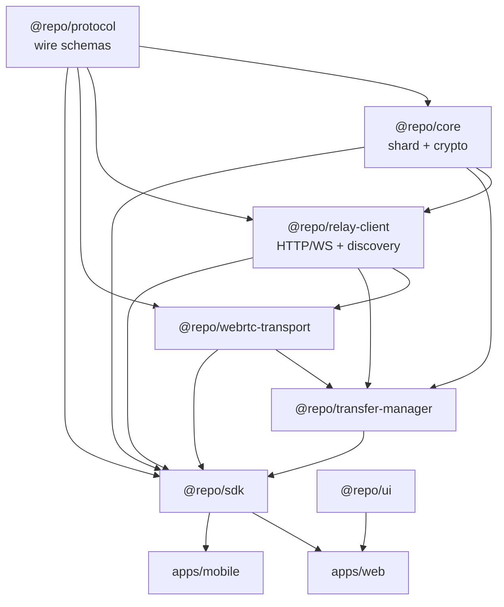

The direction is deliberate: `protocol` has no dependency on client code; `core`
contains only portable domain logic; `sdk` depends on the portable packages but
not on a platform. Platform-specific APIs (IndexedDB, cookies, Expo SecureStore,
React Native WebRTC) live only in the host apps behind adapter interfaces.

### 4.4 Turborepo and workspace boundaries

- `pnpm-workspace.yaml` includes `apps/*`, `packages/*`, `services/*`, and
  `scripts/*`.
- Turborepo builds `apps/web`, `apps/mobile`, `apps/docs`, and the TypeScript
  packages. Rust and Go remain in the same Git repository but are built by Cargo
  and Go modules, not by pnpm.
- Root scripts:
  - `pnpm build` — Turborepo build
  - `pnpm dev` — Relay + web concurrently
  - `pnpm test` — TS tests, then Go tests, then Rust tests
  - `pnpm lint`, `pnpm check-types`, `pnpm format`
- Cross-language protocol changes are made atomically in one commit: update the
  zod schema, regenerate JSON Schema, update docs, and mirror the change in Rust
  and Go.

---

## 5. System Architecture

### 5.1 High-level architecture

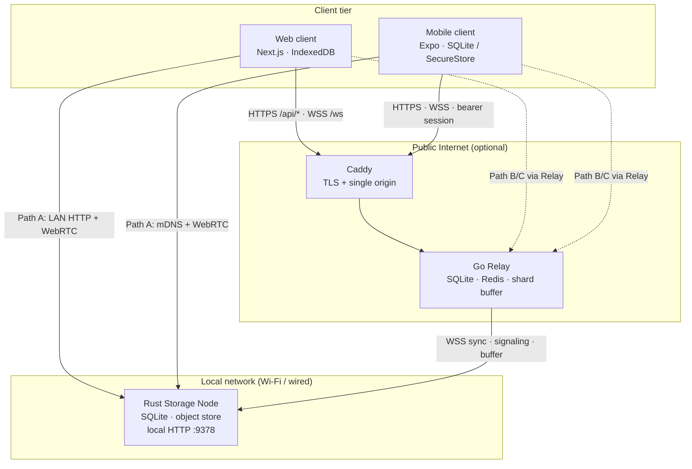

The architecture has three tiers:

1. **Clients** — hold decrypted file content only in memory, keep encrypted
   catalog/metadata in local storage, and hold device identity keys.
2. **Relay** — a public, always-on control plane. It never holds plaintext file
   keys or file contents. It does temporarily hold encrypted shards for Path C.
3. **Storage Node** — a private, user-controlled data plane. It holds encrypted
   shards and a local metadata catalogue, and is authoritative for the data it
   physically stores.

### 5.2 Control plane vs storage plane

| Concern | Control plane (Relay) | Storage plane (Node) |
|---|---|---|
| Account/device/node registry | Yes | Partial (trusted devices/nodes) |
| Sessions and authentication | Yes | Device challenge-response |
| File catalogue replica | Yes | Yes (authoritative locally) |
| File bytes | Only transient encrypted buffer | Durable encrypted objects |
| Key envelopes | Opaque storage | Opaque storage for rebuild |
| Sync journal | Yes | Yes |
| Snapshots/rebuild | Consumer | Producer |
| Push notifications | Yes | No |
| Physical integrity | No | Yes (reconciliation, GC) |

This separation is the reason the Internet can disappear without stopping local
work: the data plane does not require the control plane to function.

### 5.3 Trust boundaries

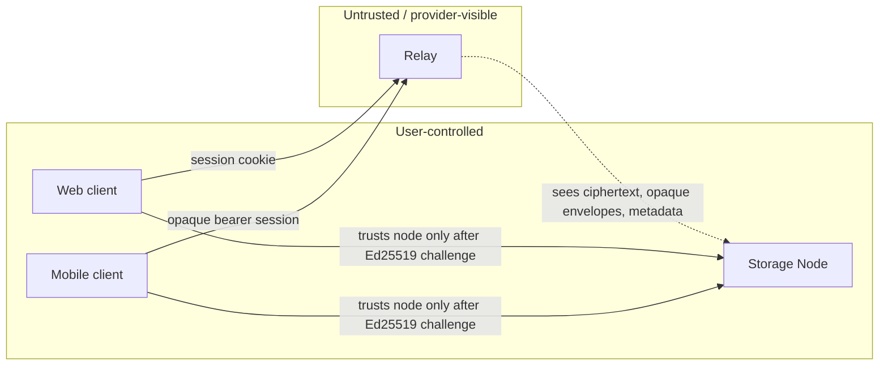

Key points:

- The Relay is **not trusted with confidentiality**. It sees ciphertext, sizes,
  timestamps, account identifiers, and routing metadata.
- The Storage Node is trusted for **availability and integrity**, but not for
  confidentiality: it stores only ciphertext and cannot open envelopes.
- The client trusts a LAN node only after verifying an Ed25519 signature against
  the pinned node ID; discovery alone is not authentication.
- The TLS boundary for the public origin is Caddy; local LAN traffic is plain
  HTTP with cryptographic authentication (see accepted risks in §8.9).

### 5.4 Runtime topology

A typical self-hosted deployment runs:

```text
One server (public origin)
  Caddy :80/:443
    ├─ /ws, /health, /rebuild, /auth/*, /devices/*, /nodes*, 
    │  /pairing/*, /buffer/*, /shards/*, /node/shards/* -> relay:8080
    └─ everything else (pages, /api/*) -> web:3000
  Relay container  -> SQLite file + Redis + buffer directory
  Web container    -> Next.js standalone server

One or more user machines
  Storage Node daemon -> ~/.nodus (identity/config)
                      -> <data_dir>/nodus.db + objects/ (data)
  Browser / phone     -> LAN (Path A) or public origin (Path B/C)
```

The Relay is **single-instance by design** because SQLite uses a process lock and
WAL sidecar files. The web app and Relay share one public origin so browser
cookies, CORS, and WebSocket origins are simple.

### 5.5 Data ownership rules

1. The node's SQLite database is authoritative for the node's local catalogue
   and objects.
2. The Relay's database is a **replicated control-plane view**, rebuildable from
   node snapshots.
3. Client local storage is a **cache plus keys**, not a replica.
4. Relay buffer contents are **transient**; absence from a node snapshot does
   not authorize deleting them (they may be pending deliveries).

---

## 6. Component Deep Dive

### 6.1 Web client (`apps/web`)

**Stack:** Next.js 16.3 App Router, React 19.2, Tailwind v4 through
`@repo/ui`, TypeScript 7, Vitest + Testing Library + fake-indexeddb.

#### 6.1.1 Structure

- **Server components** handle session-guarded pages and read server-only
  environment values (`PUBLIC_RELAY_URL`, `RELAY_URL`).
- **Client components** own the interactive catalog, upload/download UI, and
  local encrypted state.
- **Route handlers** under `app/api/*` act as a Backend-for-Frontend (BFF):
  they proxy to the Relay, attach the HttpOnly session cookie server-side, and
  apply CSRF checks.
- `middleware.ts` applies the CSRF guard to every `/api/*` request.
- `next.config.js` sets a strict Content-Security-Policy, HSTS, frame denial,
  MIME sniffing protection, and `no-store` on authenticated API responses.

#### 6.1.2 Route map

| Route | Purpose |
|---|---|
| `/` | Redirects to `/overview` if signed in, otherwise `/auth` |
| `/auth` | Multi-step sign-in / register / recovery wizard |
| `/pair` | Storage Node pairing and LAN discovery |
| `/overview` | Dashboard summary |
| `/files` | File/folder browser, upload, download, mutations |
| `/downloads` | Active downloads and history |
| `/devices` | Devices and Storage Nodes, add node, ping, rename, revoke |
| `/activity` | Account/device activity feed |
| `/conflicts` | Conflict inbox (ADR-0003) |
| `/tombstones` | Deleted items, restore, purge |
| `/security` | Envelope coverage, device revocation, recovery card |
| `/settings` | Theme, sync preferences, credentials, notifications, local reset |

#### 6.1.3 BFF route handlers

The web app exposes same-origin `/api/*` handlers for auth, devices, nodes,
files, folders, envelopes, tombstones, activities, pairing, push, shard access,
and recovery. Each handler:

1. Requires a valid session cookie (except login/register/recovery endpoints).
2. Calls the Relay at `RELAY_URL` (server-only, e.g. `http://relay:8080`).
3. Returns JSON or binary to the browser.
4. Never exposes the internal Relay URL or the session token to client code.

This design keeps the browser on a single origin and avoids CORS and token
storage in JavaScript. The Relay remains the authority on authentication and
ownership; the BFF is a proxy plus CSRF defense.

#### 6.1.4 Providers and client state

| Provider | Responsibility |
|---|---|
| `AuthProvider` | Session state, device identity/signer, logout |
| `ThemeProvider` | Light/dark/system theme persisted locally |
| `TransferProvider` | Path selection and transfer orchestration |
| `UploadProvider` | Upload queue + floating progress widget |
| `DownloadProvider` | Download queue/stage progress surviving navigation |
| `ActivityProvider` | Background sync of local activity to the account feed |
| `NotificationProvider` | Alert preferences, service worker, conflict watcher |
| `WsProvider` | Relay WebSocket connection and event dispatch |

#### 6.1.5 Local storage model

- **IndexedDB** stores the encrypted catalog cache, file/folder keys, envelopes,
  device keys, the recovery phrase, transfer log, preferences, trusted nodes,
  and upload/download progress.
- **`localStorage`** holds only small non-secret preferences and, for legacy
  compatibility, public halves of identities. The recovery phrase is kept in
  IndexedDB (matching the “trusted device” threat model) and is never sent to a
  server.
- **Device signing key:** an Ed25519 `CryptoKey` created as **non-extractable**
  in WebCrypto and stored as an opaque handle (ADR-0008). Signing goes through a
  handle; the private seed is not exportable to JavaScript.
- **Encryption key:** a separate X25519 keypair used only for FEK/folder-key
  envelopes; its public key is published to the Relay.
- The client decrypts names and file bytes only in memory for display/download.

#### 6.1.6 Key web flows

- **Auth:** register or login via `/api/auth/*`; the Relay sets an HttpOnly,
  SameSite=Lax, Secure (in production) cookie. Registration also generates a
  24-word BIP39 recovery phrase and enrolls its public key.
- **Upload:** read file → shard → encrypt each shard → hash ciphertext → upload
  file-version events and shard manifest → transfer shards via the best path.
- **Download:** resolve file version and shard locations → fetch shards via
  Path A/B/C → verify BLAKE3 → decrypt → reassemble → save through the browser.
- **Pairing:** session-authenticated call to mint a pairing code or token;
  manual LAN discovery/probe of `/nodus/discovery`; signed pairing confirm
  verified against the pinned node key.

### 6.2 Mobile client (`apps/mobile`)

**Stack:** Expo SDK 57 with Continuous Native Generation (CNG) development
build, React Native 0.86, React Navigation 7, TypeScript, Vitest.

#### 6.2.1 Why a native build

Path A requires mDNS browsing and WebRTC, which cannot load in Expo Go. The
project adopted a native/CNG development build with:

- `react-native-zeroconf` — mDNS discovery
- `react-native-webrtc` — Path A/B DataChannels
- `expo-sqlite` — local catalog, queues, transfer log
- `expo-secure-store` — session token, device/encryption seeds, Relay URL
- `expo-document-picker`, `expo-file-system`, `expo-sharing` — file I/O
- `expo-notifications`, `expo-task-manager`, `expo-background-task` — push and
  background drain
- `react-native-sse` — trickle ICE over local SSE

iOS declares `_nodus._tcp` in `NSBonjourServices`; Android declares the
multicast/Wi-Fi permissions mDNS requires.

#### 6.2.2 Navigation

The signed-in app has five bottom tabs, each with its own native stack:

| Tab | Screens |
|---|---|
| **Files** | Files, Conflicts, File detail |
| **Downloads** | Downloads |
| **Devices** | Devices, Pairing, Node detail, Device detail |
| **Activity** | Activity |
| **Settings** | Settings, Server, Security, Trash |

Signed-out users see the auth stack; first launch (no saved Relay URL) sees the
Server onboarding screen before any Relay-backed screen is reachable.

#### 6.2.3 Runtime Relay selection

Recent work replaced the build-time `EXPO_PUBLIC_RELAY_URL` with runtime
selection:

- `relay-url.ts` normalizes and validates URLs (scheme inference, WebSocket
  mapping, trailing slashes, IPv6 loopback, cleartext rejection).
- `relay-config.ts` persists the selected origin in SecureStore and probes
  `/health`.
- The runtime hook loads the URL before restoring a session.
- Changing servers revokes the old session, clears the local token and Path D
  queue, and resets account-scoped state. This prevents replaying a session
  token to a newly entered server.

#### 6.2.4 Local storage and background work

- `expo-sqlite` holds catalog, folders, keys, envelopes, sync state, trusted
  nodes, path cache, transfer log, upload progress, the Path D queue, and the
  recovery phrase (sealed with an AES-256-GCM data key).
- `expo-secure-store` holds the device-bound at-rest data key, device identity
  seeds, session token, and the Relay URL.
- A headless background task drains the Path D queue when connectivity returns;
  it hydrates the saved Relay URL before posting.
- Path A discovery and transfer are foreground-only (ADR-0004), avoiding iOS and
  Android background execution complexity.

### 6.3 Shared TypeScript packages

#### `@repo/core`

Portable domain logic with no platform dependencies:

- **Sharding:** `splitIntoShards`, `reconstructFromShards`, size resolution
  (default 8 MiB, min 1 MiB, max 32 MiB).
- **Crypto:** AES-256-GCM shard encryption/decryption, packed
  `nonce || ciphertext`, BLAKE3 hashing, filename encryption, FEK generation,
  X25519 key generation/derivation, sealed-box FEK envelopes.
- **Recovery:** BIP39 phrase → HKDF-SHA256 → Ed25519 seed derivation.
- **Backoff:** exponential backoff with jitter.
- **Types and metadata helpers.**

#### `@repo/protocol`

The canonical wire contract:

- zod schemas for every message and event payload.
- `parseMessage(raw)` validates the envelope, checks `schema_version`, dispatches
  to the payload schema, and returns a typed result or structured error. It
  never throws on malformed input.
- Generates deterministic JSON Schema artifacts under `schemas/` for Rust and Go.
- Current schema version: **1.8** (major.minor; patch tolerated).
- Branded protocol IDs with mapping helpers at the core boundary.

#### `@repo/sdk`

The single client implementation shared by web and native. It owns:

- Auth/session, device identity, WebCrypto signer.
- Catalog and folder projections.
- Key envelopes (seal/open, backfill, folder keys).
- Upload and download services (including adaptive concurrency).
- Transfer attempt-path construction and signed Relay signaling.
- Persistent WebRTC session cache.
- Recovery (online and resealing).
- Conflicts and ZIP export.

Platform differences are injected through adapters: `RelayHttp`, `LocalStore`,
`SecureStore`, `FileSource`/`FileSink`, `WebRtcFactory`, `WebSocketFactory`,
`CryptoRuntime`, `Connectivity`, and `PlatformCapabilities`.

#### `@repo/relay-client`

- Relay HTTP client and authenticated WebSocket client.
- LAN discovery: mDNS advertisement parsing, node URL normalization,
  `/nodus/discovery` probing, Ed25519 challenge-response authentication.
- Signed request headers for node-to-node shard fetch.
- Helpers to verify signed pairing confirms and WebRTC answers.

#### `@repo/webrtc-transport`

Browser and React Native WebRTC abstraction: peer connection creation, data
channel setup, SDP/ICE handling, binary framing, and signed session messages.

#### `@repo/transfer-manager`

Cross-path orchestration:

- Ordered fallback: local signaling → relay signaling → buffer relay → local
  queue.
- Path cache (last successful path per node), with immediate eviction on failure.
- Bounded concurrency pool (default 4).
- Exponential backoff with jitter, two retries per stage.
- Local queue interface for Path D, with in-memory default and platform
  backends.

#### `@repo/ui`

Shared React/Tailwind v4 design system: tokens, primitives (buttons, inputs,
dialogs, badges, sections, page headers, icons), and accessible light/dark
themes. The web UI is a port of the original design prototype.

### 6.4 Relay (`services/relay`)

**Stack:** Go 1.27, `net/http` mux, gorilla WebSocket, modernc SQLite, Redis,
Argon2id, Web Push/Expo push.

#### 6.4.1 Startup sequence

`main.go`:

1. Parse `--factory-reset` / `--factory-reset-force` before any server work.
2. Load configuration from environment.
3. Open SQLite, run embedded migrations, acquire the exclusive DB lock.
4. Connect to Redis (optional degradation if unavailable).
5. Initialize the shard buffer directory.
6. Start the WebSocket hub with a shard-size-aware frame limit.
7. Start background workers: buffer TTL sweep (30 min), tombstone prune (1 h),
   rebuild-request prune (1 h).
8. Register routes and start the HTTP server with timeouts.
9. On SIGINT/SIGTERM, cancel context and shut down gracefully (10 s).

#### 6.4.2 Responsibilities

- **Auth:** register/login/logout, opaque sessions, password change, logout-all,
  online recovery challenge/verify.
- **Devices:** register, list, revoke, rename, ping, push token registration, web
  push subscription management.
- **Nodes:** register, list, rename, ping, verify URL.
- **Pairing:** node bootstrap codes, device↔node pairing sessions, LAN token
  verification.
- **Catalog:** files, folders, envelopes, folder envelopes, activities,
  tombstones, conflict resolution.
- **Sync:** WebSocket `event_batch` ingestion, cursor tracking, per-peer
  whitelists, projection into the control-plane tables.
- **Buffer:** `POST /buffer/upload`, signed `GET /buffer/fetch`, single-use Redis
  fetch tokens, TTL and recovery sweeps.
- **Downloads:** `GET /shards/{object_id}` for browsers, and
  `GET /node/shards/{object_id}` for peer repair, proxying to the owning node
  over WebSocket if needed.
- **WebRTC:** pure signaling relay (`webrtc_offer`, `webrtc_answer`,
  `webrtc_ice_candidate`); it never carries file bytes on this channel.
- **Rebuild:** request a snapshot from the primary node, validate/assemble
  chunks, promote the rebuilt state atomically.
- **Notifications:** conflicts, node offline, backup complete via Expo/Web Push.

#### 6.4.3 WebSocket hub

- One connection per client; maps by connection ID, account, node ID, and device
  ID.
- Authenticates browsers via the session cookie (with origin allowlist), and
  nodes via Ed25519 challenge-response.
- Per-connection token-bucket rate limiting (burst 250, refill 100/s).
- Ping/pong liveness (60 s pong wait, 54 s ping period).
- Peer-offline hook fires only for Storage Nodes, not client devices (clients
  reconnect constantly).
- Delivery of pending buffered shards on node reconnect with fresh fetch tokens.

#### 6.4.4 Relay storage choices

- **SQLite** for durable control-plane data: one baseline migration, `STRICT`
  tables, WAL mode, `busy_timeout`, foreign keys on, `_txlock=immediate` for the
  writer pool. Timestamps are integer Unix milliseconds. A custom `now()` scalar
  keeps queries simple.
- **Redis** for ephemeral state: presence, nonces, rate limits, fetch tokens,
  pending notifications. Redis is not the source of truth for sessions.
- **Filesystem buffer** for encrypted shards awaiting pickup: 0700 directory,
  0600 files, atomic temp-write-then-rename.

### 6.5 Storage Node (`services/storage-node`)

**Stack:** Rust 2024, tokio, axum, sqlx/SQLite, ed25519-dalek, blake3, `webrtc`,
tokio-tungstenite, libmdns/mdns, clap, dialoguer.

#### 6.5.1 CLI and first run

- Bare `nodus` on a TTY opens an interactive menu.
- Non-interactive invocations boot the daemon directly.
- `nodus node start` boots the daemon.
- `nodus node pair --relay <url> --code <code>` pairs then boots.
- `--data-dir` overrides `NODUS_DATA_DIR`; first run can prompt.
- Config lives in `~/.nodus/config.toml`; the identity lives in
  `~/.nodus/identity/`.
- Data (`nodus.db`, `objects/`, `temp/`, `logs/`) lives in the user-chosen data
  directory (default suggestion `~/NodusBackup`).
- First-run validation warns about cloud-sync folders and network/removable
  mounts, and requires explicit adoption of a directory that already contains
  node data.

#### 6.5.2 Identity

- A persistent Ed25519 keypair is generated once; the node ID is the hex public
  key.
- The node signs WebSocket challenge nonces, pairing confirms, WebRTC answers,
  node-to-node fetch requests, and snapshots.
- The private key is read through a zeroizing buffer.

#### 6.5.3 Object store

- Content-addressed: `<data_dir>/objects/<first-two-hex>/<object_id>` where
  `object_id` is the BLAKE3 hash of the encrypted shard bytes.
- Writes are atomic: write to `temp/`, fsync file, fsync directory, rename into
  place.
- Startup recovers incomplete temporary writes.
- Deduplication is natural: identical ciphertext hashes to the same object.
- SQLite `storage_objects` tracks physical objects and status:
  `PENDING`, `STORED`, `DEGRADED`, `PERMANENTLY_MISSING`.
- `shards` maps `(file_id, version_number, shard_index) → object_id`.
- `file_version_shard_hashes` stores signed per-shard hashes so a compromised
  Relay or peer cannot plant the first copy of a shard.

#### 6.5.4 Sync engine

- Connects to the Relay over WSS.
- Authenticates with `node_auth_challenge` → `node_auth_response` → result.
- Registers with capabilities (storage, signaling, sync) and receives peer nodes.
- Seeds `trusted_nodes` from authenticated peers.
- Exchanges `sync_hello` / `sync_status`, then `event_batch` in both directions.
- Applies events idempotently inside a single transaction per event; projections,
  event journal insert, and cursor update commit together.
- Maintains a durable `sync_outbox`; drains unsynced events and marks them
  acknowledged. Per-origin sequence uniqueness is enforced by a unique index.
- Handles tombstones before projections to prevent resurrection.
- Verifies shard manifests from paired devices and marks mismatched stored
  objects `DEGRADED`.

#### 6.5.5 Local HTTP listener

Plain HTTP on port 9378 with permissive CORS, serving:

- Discovery advertisement.
- Challenge/nonce issuance and device authentication.
- Relay-issued pairing token redemption.
- Offline recovery challenge/auth/envelopes.
- LAN activity feed.
- Authenticated node-to-node shard fetch.
- WebRTC offer/ICE signaling.

Security comes from Ed25519 challenge-response and signed payloads, not transport
encryption. See §8.9 for accepted risks.

#### 6.5.6 Transfer manager

Mirrors the TypeScript transfer manager contract:

- Path A: local signaling via fresh mDNS + WebRTC.
- Path B: Relay signaling + WebRTC.
- Path C: buffer-and-relay HTTP.
- Path D: persistent queue when the Relay is unreachable.

For node-to-node repair, Path A uses authenticated plain HTTP
(`GET /nodus/shard/{object_id}`) because the node’s WebRTC manager accepts
inbound offers only from paired devices, not other nodes. Paths B/C/D remain
honest failures for node-to-node repair in v1.

#### 6.5.7 GC, reconciliation, and repair

- **GC:** keep the 5 newest versions or all versions younger than 30 days
  (whichever keeps more); retain tombstones 90 days; delete unreferenced objects
  after a 24-hour grace period. Runs as a background job with a maintenance lock.
- **Reconciliation:** pages through `STORED` objects, hashes files, marks missing
  or corrupted objects `DEGRADED`, and deletes orphaned files only past the
  grace period. Uses keyset pagination to avoid skipping rows while mutating.
- **Repair:** for `DEGRADED` objects, query trusted peers, order by path-cache
  hits then last success, fetch from the best peer, verify BLAKE3, atomically
  write, and flip back to `STORED`. Failed repairs retry on the next scan.

---

## 7. Data Model and Database Design

### 7.1 Storage layers

| Store | Technology | Scope | Durability |
|---|---|---|---|
| Relay control plane | SQLite (single file + WAL) | Accounts, devices, nodes, sessions, catalog replica, envelopes, events, tombstones, rebuild staging | Durable |
| Relay ephemeral state | Redis | Presence, nonces, rate limits, fetch tokens, pending notices | Ephemeral |
| Relay shard buffer | Filesystem | Encrypted shards awaiting node pickup | Transient (TTL) |
| Node catalogue | SQLite (single file + WAL) | Files, versions, shards, objects, trust, events, tombstones | Durable |
| Node object store | Filesystem | Encrypted shard blobs, content-addressed | Durable |
| Client cache | IndexedDB / SQLite | Catalog cache, keys, envelopes, queues, logs | Durable per device |

### 7.2 Relay SQLite schema

The Relay uses one embedded baseline migration
(`services/relay/internal/db/sqlite_migrations/0001_baseline.up.sql`). Tables are
`STRICT`, timestamps are integer Unix milliseconds, and foreign keys are
enforced.

#### 7.2.1 Groups of tables

| Group | Tables |
|---|---|
| Accounts & auth | `accounts`, `sessions`, `recovery_challenges` |
| Devices | `devices`, `push_tokens`, `web_push_subscriptions` |
| Storage nodes | `storage_nodes` |
| Node bootstrap pairing | `pairing_codes` |
| Device↔node pairing | `pairing_sessions` |
| Catalog | `files`, `file_versions`, `file_version_shard_hashes`, `file_locations`, `folders` |
| Key material | `key_envelopes`, `folder_key_envelopes` |
| Sync | `sync_events`, `sync_cursors`, `sync_notices`, `activities`, `conflict_notices` |
| Tombstones | `tombstones`, `tombstone_node_status` |
| Rebuild staging | `rebuild_files`, `rebuild_file_versions`, `rebuild_file_version_shard_hashes`, `rebuild_folders`, `rebuild_folder_key_envelopes`, `rebuild_key_envelopes`, `rebuild_tombstones`, `rebuild_activities`, `rebuild_requests` |

#### 7.2.2 Accounts, sessions, and recovery

| Table | Key columns | Purpose |
|---|---|---|
| `accounts` | `account_id` PK, `email` unique, `password_hash`, `recovery_public_key`, `created_at` | Account identity and Argon2id password hash |
| `sessions` | `session_id` PK, `session_hash` unique, `account_id`, `device_id`, `expires_at`, `last_used_at`, `revoked_at` | Opaque server-side sessions; only the SHA-256 hash of the token is stored |
| `recovery_challenges` | `nonce` PK, `account_id`, `expires_at`, `used_at` | Single-use online recovery nonces |

Session properties:

- Absolute lifetime: 30 days (configurable).
- Raw token is sent once as `HttpOnly; Secure; SameSite=Lax` cookie; never
  stored server-side.
- `last_used_at` is touched at most every 30 minutes to avoid write
  amplification; there is no automatic idle logout.
- Maximum 10 active sessions per account; an 11th revokes the oldest.
- Privilege changes (password change, device revocation) rotate or revoke
  affected sessions.

#### 7.2.3 Devices and nodes

| Table | Key columns | Purpose |
|---|---|---|
| `devices` | `device_id` PK, `account_id`, `public_key`, `encryption_public_key`, `status`, `revoked_at`, platform/browser metadata, `last_seen_at` | Registered client devices |
| `storage_nodes` | `node_id` PK, `account_id`, `public_key`, `capabilities`, `status`, `is_primary`, `display_name`, `used_bytes`, `total_bytes`, `last_promoted_snapshot_sequence` | Registered Storage Nodes; a partial unique index enforces one primary node per account |
| `push_tokens` | `device_id` PK, `account_id`, `token`, `platform`, notification prefs | Expo mobile push |
| `web_push_subscriptions` | `endpoint` PK, `account_id`, `p256dh`, `auth`, prefs | Browser Web Push |

#### 7.2.4 Pairing

| Table | Key columns | Purpose |
|---|---|---|
| `pairing_codes` | `code_hash` PK, `account_id`, `status`, `node_id`, `expires_at`, `consumed_at` | One-time `NODUS-XXXX-XXXX` node bootstrap codes; only SHA-256 hash stored |
| `pairing_sessions` | `id` PK, `account_id`, `node_id`, `device_id`, `device_public_key`, `token` unique, `status`, `expires_at`, `consumed_at` | Short-lived device→node pairing tokens |

#### 7.2.5 Catalog

| Table | Key columns | Purpose |
|---|---|---|
| `files` | `file_id` PK, `account_id`, `parent_folder_id`, `encrypted_name`, `preferred_version`, timestamps | File identity and tree position; names are opaque |
| `folders` | `folder_id` PK, `account_id`, `parent_folder_id`, `encrypted_name`, timestamps | Folder tree |
| `file_versions` | `(file_id, version_number)` PK, `parent_version_id`, `conflict_status`, `version_hash`, `shard_count`, `conflicted_name`, `created_at` | Immutable versions; `conflict_status ∈ {none, flagged, resolved}` |
| `file_version_shard_hashes` | `(file_id, version_number, shard_index)` PK, `shard_hash` | Signed per-shard hashes |
| `file_locations` | `(file_id, version_number, shard_index, node_id)` PK, `status`, `buffer_id`, `hash`, `size_bytes`, `source_device`, `updated_at` | Per-shard custody/lifecycle (see §11.1) |

`files.preferred_version` records a user’s “Keep A” choice after a conflict.
Choosing a version is non-destructive: all versions and shards remain.

#### 7.2.6 Key envelopes

| Table | Key columns | Purpose |
|---|---|---|
| `key_envelopes` | `(file_id, recipient_id)` PK, `recipient_kind`, `encrypted_key`, `created_at` | FEK sealed for a device, node, or recovery identity |
| `folder_key_envelopes` | `(folder_id, recipient_id)` PK, `recipient_kind`, `encrypted_key` | Folder key sealed for a recipient |

`recipient_kind ∈ {device, node, recovery}`. The Relay stores the ciphertext but
never possesses a plaintext FEK or folder key. Revoking a device deletes only its
envelopes; file keys are not rotated (ADR-0001).

#### 7.2.7 Sync, activity, and conflicts

| Table | Key columns | Purpose |
|---|---|---|
| `sync_events` | `event_id` PK, `account_id`, `origin_id`, `origin_sequence`, `event_type`, `payload`, `timestamp`; unique `(account_id, origin_id, origin_sequence)` | Durable event journal |
| `sync_cursors` | `(account_id, peer_id)` PK, `last_sequence`, `updated_at` | Per-origin cursor |
| `sync_notices` | `(account_id, file_id, version_number)` PK, `notified_at` | “Backup complete” notification dedupe |
| `activities` | `(account_id, activity_id)` PK, `origin_id`, `kind`, `outcome`, `file_id`, `path`, `detail`, `created_at` | Account-wide activity feed |
| `conflict_notices` | `(account_id, file_id)` PK, `notified_at` | Conflict notification dedupe |

#### 7.2.8 Tombstones

| Table | Key columns | Purpose |
|---|---|---|
| `tombstones` | `(account_id, entity_type, entity_id)` PK, `deleted_at`, `purge_after`, `purge_requested_at` | Soft-delete record; retention follows the row |
| `tombstone_node_status` | `(account_id, entity_type, entity_id, node_id)` PK, `deleted_at`, `purged_at` | Per-node delete/purge progress |

#### 7.2.9 Rebuild staging

The `rebuild_*` tables stage a snapshot before promotion. They mirror the live
catalog plus folders, envelopes, tombstones, and activities. `rebuild_requests`
tracks requested rebuilds with a 30-day audit window.

#### 7.2.10 Relay entity relationships

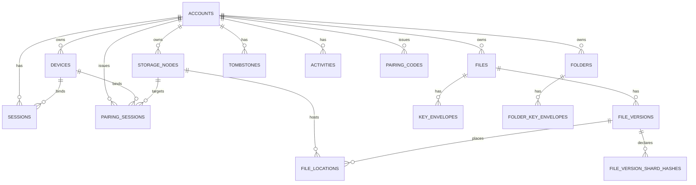

### 7.3 Storage Node SQLite schema

The node schema is built from 15 forward-only migrations under
`services/storage-node/migrations/`. Timestamps are ISO 8601 UTC strings, WAL
mode and foreign keys are enabled per connection.

#### 7.3.1 Catalogue and object store

| Table | Key columns | Purpose |
|---|---|---|
| `files` | `file_id` PK, `parent_folder_id`, `encrypted_name`, timestamps | File identity |
| `folders` | `folder_id` PK, `parent_folder_id`, `encrypted_name`, timestamps | Folder tree |
| `file_versions` | `(file_id, version_number)` PK, `parent_version_id`, `version_hash`, `shard_count`, `conflict_status`, `conflicted_name`, `created_at` | Immutable versions |
| `file_version_shard_hashes` | `(file_id, version_number, shard_index)` PK, `shard_hash` | Signed manifest hashes |
| `storage_objects` | `object_id` PK (BLAKE3 hex), `size_bytes`, `status`, `created_at` | Physical object index |
| `shards` | `(file_id, version_number, shard_index)` PK, `object_id`, `size_bytes` | Logical shard → object mapping |

Indexes support GC refcount checks (`shards.object_id`), reconciliation by
status, tombstone expiry, folder rollups, and updated-at ordering.

#### 7.3.2 Identity and trust

| Table | Key columns | Purpose |
|---|---|---|
| `devices` | `device_id` PK, `public_key_bytes` BLOB, `status`, `paired_at`, `last_authenticated_at`, `revoked_at` | Paired devices |
| `trusted_nodes` | `node_id` PK, `public_key_bytes`, `created_at`, `last_successful_path`, `last_success_at` | Peer nodes for repair + path cache |
| `node_account` | `id = 1` check, `account_id`, `paired_at` | The single account this node is bound to (offline recovery) |

#### 7.3.3 Sync

| Table | Key columns | Purpose |
|---|---|---|
| `sync_events` | `event_id` PK, `origin_id`, `origin_sequence`, `event_type`, `payload`, `timestamp`; unique `(origin_id, origin_sequence)` | Durable event journal |
| `sync_outbox` | `event_id` PK, `origin_id`, `origin_sequence`, `event_type`, `payload`, `created_at`, `synced`; unique `(origin_id, origin_sequence)` | Events to push to the Relay |
| `sync_cursors` | `peer_id` PK (node/device/relay), `last_sequence_seen`, `updated_at` | Cursor exchange |
| `pending_shard_fetches` | `(file_id, version_number, shard_index)` PK, `object_id`, `size_bytes`, `fetched_at` | Shards fetched before their version event arrives |

#### 7.3.4 Keys, pairing, and security

| Table | Key columns | Purpose |
|---|---|---|
| `key_envelopes` | `(file_id, recipient_id)` PK, `recipient_kind` (device/node/recovery), `encrypted_key` | Opaque FEK envelopes for rebuild/recovery |
| `folder_key_envelopes` | `(folder_id, recipient_id)` PK, `recipient_kind`, `encrypted_key` | Opaque folder-key envelopes |
| `pairing_sessions` | `token` PK, `device_public_key` BLOB, `node_id`, `account_id`, `issued_at`, `expires_at`, `consumed_at` | Relay-issued pairing tokens pushed over WS |
| `security_events` | `id` PK, `event_type`, `device_id`, `file_id`, `detail`, `created_at` | Durable audit trail (e.g. missing envelope on download) |

#### 7.3.5 Tombstones and snapshots

| Table | Key columns | Purpose |
|---|---|---|
| `tombstones` | `(entity_type, entity_id)` PK, `deleted_at` | Prevent resurrection; retained 90 days |
| `snapshot_counter` | `counter_name` PK, `value` | Monotonic snapshot sequence, persisted across restarts |

#### 7.3.6 Node entity relationships

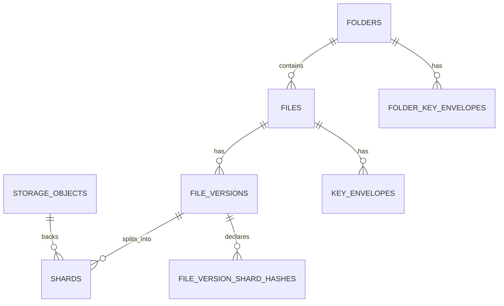

The identity/trust tables (`devices`, `trusted_nodes`, `node_account`) and the
sync/journal tables (`sync_events`, `sync_outbox`, `sync_cursors`,
`pending_shard_fetches`) are deliberately not linked by foreign keys to the
catalogue: trust and event ingestion must work even when a referenced catalogue
row has not arrived yet, and a failed projection is retried by replaying the
journal rather than by cascading a delete.

### 7.4 Redis keys and usage

Redis holds only ephemeral, reconstructible state:

| Concern | Key pattern (conceptual) | Purpose |
|---|---|---|
| Presence | per account/peer | Online status |
| Auth nonces | `auth:nonce:<id>` | Node/device challenges |
| Recovery nonces | dedicated namespace | Recovery ceremony separation |
| Fetch tokens | `fetch_token:<token>` | Single-use Path C shard pickup (GETDEL) |
| Rate limits | per-IP buckets | Pairing, recovery, ICE |
| Pending notifications | per peer | Buffered shard prompts |

Redis is optional at runtime: the Relay degrades to limited functionality if it
cannot connect, but a production deployment requires it (Compose enforces a
password).

### 7.5 Object store layout

```text
<data_dir>/
├─ nodus.db                  # SQLite catalogue
├─ objects/
│  ├─ ab/
│  │  └─ <blake3-hex>        # encrypted shard bytes
│  └─ cd/
│     └─ <blake3-hex>
├─ temp/                     # atomic write staging
└─ logs/
```

Properties:

- The filename is the BLAKE3 hash of the **encrypted** bytes, not plaintext.
- The node never sees plaintext or a decryption key.
- Atomic writes (temp → fsync → rename) prevent torn files across crashes.
- Orphaned files are deleted only after a 24-hour grace period.

### 7.6 Relay shard buffer

- Directory mode `0700`, file mode `0600`.
- One file per `buffer_id`, written atomically.
- Metadata in `file_locations` and `buffer_id`.
- TTL default 72 hours; orphaned `UPLOADING` rows are cleaned after a 1-hour
  grace.
- Stuck `NODE_RECEIVING`/`NODE_VERIFIED` rows revert to `RELAY_BUFFERED` after a
  30-minute grace so redelivery can occur.

### 7.7 Client local data

| Platform | Store | Contents |
|---|---|---|
| Web | IndexedDB | Catalog cache, file/folder keys, envelopes, device keys, recovery phrase, trusted nodes, transfer log, queues, preferences |
| Web | `localStorage` | Small non-secret preferences and legacy public-key caches |
| Mobile | `expo-sqlite` | Catalog, folders, keys, envelopes, sync state, trusted nodes, path cache, transfer log, upload progress, Path D queue, sealed recovery phrase |
| Mobile | `expo-secure-store` | At-rest data key, device/encryption seeds, session token, Relay URL |

Client data is not a replica. It is a cache for fast local reads plus the keys
needed to decrypt this device’s files.

---

## 8. Security and Cryptography

### 8.1 Identity layers

Nodus deliberately separates four identities:

| Layer | Mechanism | Verifier | Stored where |
|---|---|---|---|
| **Account** | Email + Argon2id password → opaque session | Relay `sessions` lookup | Relay SQLite (hash only) |
| **Device** | Ed25519 signing key (non-extractable on web, keychain on native) | Signature / device registration | Device + Relay `devices.public_key` |
| **Storage Node** | Ed25519 keypair; node ID = hex public key | Challenge-response + signed messages | Node identity dir + Relay `storage_nodes.public_key` |
| **File encryption** | Per-file AES-256 key wrapped in envelopes | Cryptographic; servers never hold the FEK | Client keys + opaque envelopes |

This separation allows a device to be revoked without destroying the account or
rotating every file key.

### 8.2 Key hierarchy

```text
Account
├─ Recovery phrase (BIP39, 24 words)
│   └─ HKDF-SHA256("nodus-recovery-identity-v1") → Ed25519 seed
│       └─ Ed25519 recovery identity (public key enrolled on account)
├─ Device A
│   ├─ Ed25519 signing key (non-extractable WebCrypto key on web)
│   └─ X25519 encryption keypair (FEK envelopes)
├─ Device B
│   ├─ Ed25519 signing key
│   └─ X25519 encryption keypair
└─ Storage Node
    ├─ Ed25519 identity (signing, node ID)
    └─ X25519 encryption key (derived or separate at registration)

Per file:
  FEK (random 32 bytes)
    ├─ sealed to Device A X25519 public key
    ├─ sealed to Device B X25519 public key
    ├─ sealed to Node X25519 public key
    └─ sealed to Recovery X25519 public key
```

Two constructions are supported:

1. **Derived encryption key (ADR-0001):** X25519 encryption keypair derived from
   the Ed25519 identity via the Edwards→Montgomery conversion. Used for nodes
   and recovery identities.
2. **Independent encryption key (ADR-0008):** a standalone X25519 keypair whose
   public half is published on registration. Used by devices so the signing key
   can be non-extractable.

### 8.3 File encryption and sharding

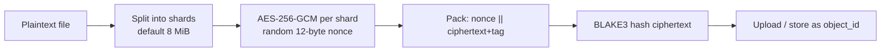

Details:

- **FEK:** 32 random bytes per file, generated once.
- **Shard size:** default 8 MiB; configurable 1–32 MiB. The size is a client
  choice; the node accepts any shard up to its cap.
- **Nonce:** 12 random bytes per shard; packed with ciphertext as
  `nonce(12) || ciphertext(+16-byte GCM tag)`.
- **Integrity:** BLAKE3 over the encrypted bytes gives a content address and
  detects corruption without exposing plaintext. GCM’s tag provides
  authenticated encryption tied to the FEK.
- **Names:** encrypted under the file’s FEK with AES-256-GCM and a random nonce;
  format `v1.<hex nonce>.<hex ciphertext+tag>`. The Relay and node never see
  plaintext names.
- **Reassembly:** shards are sorted by index; gaps, duplicates, or an empty list
  are errors. A 0-byte file is represented by exactly one 0-byte shard.

### 8.4 Key envelopes (FEK distribution)

An envelope is an **anonymous sealed box**:

1. Generate an ephemeral X25519 keypair.
2. ECDH with the recipient’s static X25519 public key.
3. HKDF-SHA256 (info `nodus-fek-envelope-v1`) derives a 32-byte symmetric key.
4. AES-256-GCM encrypts the FEK under that key.
5. Discard the ephemeral private key.
6. Store `{ephemeral_public_key, nonce, ciphertext}` in the envelope.

Recipients reverse the process with their static private key. Sender
authenticity is not a goal; confidentiality from the Relay is.

Envelopes are event-sourced (`KEY_ENVELOPE_ADDED`,
`FOLDER_KEY_ENVELOPE_ADDED`), projected into the Relay, stored opaquely on the
node, and included in snapshots so a rebuild preserves them. Revoking a device
deletes its envelopes without touching other recipients.

### 8.5 Password and session security

- Passwords are hashed with **Argon2id** using OWASP-recommended parameters
  (`m=65536, t=3, p=2`, 32-byte salt, 32-byte key), encoded in a standard
  `$argon2id$...` string.
- The raw session token is 256-bit random, sent once as an HttpOnly cookie.
  Only its SHA-256 hash is stored. Logout/revocation invalidates immediately.
- Session fixation defense: credential changes rotate the session (new ID, old
  revoked).
- CSRF: the web BFF checks `Origin`/`Sec-Fetch-Site` for mutating `/api/*`
  requests; SameSite=Lax cookies add defense in depth.
- CSP, HSTS, `X-Frame-Options: DENY`, `nosniff`, and a restrictive
  `Permissions-Policy` are set by Next.js.
- Rate limiting protects pairing, recovery, and WebRTC ICE endpoints.

### 8.6 Node bootstrap pairing (Relay)

First-time node association uses a one-time code:

1. Signed-in user calls `POST /pairing/codes`; the Relay generates
   `NODUS-XXXX-XXXX` from a 32-symbol alphabet (≈2^40 space), stores only
   `sha256(normalize(code))`, sets a 15-minute TTL, and returns the plaintext
   once.
2. The operator runs `nodus node pair --relay <url> --code <code>`.
3. The node calls `POST /pairing/codes/redeem` with `{code, node_id,
   public_key}` over HTTPS.
4. The Relay atomically consumes the code and upserts the `storage_nodes` row in
   one transaction. A rejected registration rolls back, so the code is not
   burned.
5. The node ID’s Ed25519 key is immutable: same key is idempotent; a different
   key returns `node_key_mismatch`; a revoked node is never silently revived.
6. Permanent authentication after pairing is the node’s Ed25519 WS
   challenge-response — the code is never reused.

Failure reasons: `code_unknown`, `code_expired`, `code_revoked`,
`code_consumed`, `node_owned_elsewhere`, `node_key_mismatch`, validation errors,
`rate_limit_exceeded`.

### 8.7 Device↔node LAN pairing

1. The Relay mints a device-bound, single-use token
   (`POST /pairing/sessions`) and pushes it to the node over WS.
2. The client presents the token plus its device public key to
   `POST /nodus/pair`.
3. The node checks its local `pairing_sessions`; on a miss it calls the Relay’s
   verify endpoint (atomic redemption).
4. On success the node stores the device public key and returns a signed pairing
   confirm.
5. The client verifies the confirm against the pinned node ID.

Tokens are 15-minute TTL, single-use, device-bound, and verified both locally and
at the Relay. Offline first-time pairing is not supported in v1.

### 8.8 LAN authentication and signing

- **Discovery** (`GET /nodus/discovery`) returns `node_id`, `public_key`,
  `schema_version`, and `pk_fp` (first 8 bytes of BLAKE3(pubkey)).
- **Challenge** (`POST /nodus/challenge`) returns a 32-byte single-use nonce with
  a 30-second TTL, plus the node’s identity and a signature over
  `nodus-local-auth:{nonce}`. The client verifies the node.
- **Device auth** (`POST /nodus/auth`) sends `{device_id, nonce, signature}`;
  the node verifies the Ed25519 signature over the nonce against the paired
  device key.
- **Pair confirm** is signed over
  `nodus-pair-confirm:{node_id}:{device_id}:{device_public_key}`.
- **WebRTC answers** are signed over
  `nodus-webrtc-answer:{session_id}:{sdp}`.
- **Node-to-node fetch** uses stateless signed headers:
  `X-Nodus-Node-Id`, `X-Nodus-Timestamp` (±60 s), and
  `X-Nodus-Signature` over `{node_id}:{object_id}:{timestamp_ms}`.

A node ID is the hex public key, so the pinned node ID is itself the verification
key. This prevents a rogue LAN host from impersonating a node or swapping SDP.

### 8.9 Threat model and accepted risks

| Threat | Mitigation |
|---|---|
| Relay reads file contents | Client-side AES-256-GCM; Relay only sees ciphertext |
| Relay reads file names | Names encrypted under the FEK |
| Relay reads file keys | FEK sealed in envelopes; Relay never has plaintext |
| Stolen Relay database | Ciphertext only; metadata exposure bounded |
| Lost Relay database | Signed node snapshots rebuild it |
| Stolen pairing code | Hashed at rest, 15-min TTL, single-use, rate limited, HTTPS |
| Replay of pairing token | Single-use atomic consume, device-bound |
| Rogue LAN node | Ed25519 challenge/confirm/answer signatures pinned to node ID |
| Replayed LAN auth | Single-use nonces with 30-second TTL |
| On-path SDP swap | Signed signaling payloads |
| Stolen device | Revoke envelope access; no file-key rotation in v1 |
| Long-offline device resurrects deletes | Tombstones retained 90 days |
| Compromised Relay plants shards | Signed per-shard manifest verified by the node |
| Disk corruption | Reconciliation marks `DEGRADED`, repair re-fetches and verifies |
| Brute force | Argon2id, code space, per-IP rate limits |
| CSRF / XSS | Same-origin BFF, CSRF guard, CSP, HttpOnly cookies, non-extractable signing key |

**Accepted risks (v1):**

- Plain HTTP on the LAN listener. Handshake bytes can be observed, but
  signatures prevent impersonation; bulk data uses WebRTC DTLS.
- A device compromised before revocation retains already-downloaded ciphertext
  and keys.
- Recovery phrase is stored on the local device (matching the trusted-device
  threat model) and is the user’s responsibility.
- Node signing keys are immutable; intentional key rotation requires a separate
  flow.
- The Relay is a single instance; SQLite locking prevents horizontal scaling.

### 8.10 Revocation

Revoking a device:

1. Marks `devices.status = REVOKED` and sets `revoked_at`.
2. Deletes the device’s `key_envelopes` and `folder_key_envelopes`.
3. Revokes its sessions.
4. Emits `DEVICE_REVOKED` so nodes/clients update their views.

Because envelopes are per-recipient, revocation is O(1) and does not require
re-encrypting files. A revoked device can no longer obtain new FEKs, though it
may retain copies of previously decrypted data (explicitly accepted).

---

## 9. Protocol Design

### 9.1 Message envelope

Every WebSocket message shares an envelope:

```json
{
  "type": "shard_upload",
  "schema_version": "1.8",
  "message_id": "uuid",
  "payload": { "...": "..." }
}
```

- Field names are `snake_case` on the wire.
- `message_id` is globally unique and used for correlation.
- `schema_version` is per-message, not negotiated once.
- `parseMessage` validates the envelope, checks compatibility, dispatches to the
  payload schema, and returns a typed result or structured error.

### 9.2 Versioning

Format: `major.minor` (a trailing `.patch` is tolerated; Rust/Go emit `1.0.0`).

| Change | Bump |
|---|---|
| Remove/rename a field, change a type, change meaning, add a required field | Major |
| Add an optional field, widen an enum, add a new message type | Minor |

Compatibility rule: same major, any minor is accepted. A different major is
rejected with `incompatible_version`. Current version: **1.8**, which added the
`recovery` envelope recipient kind.

Generated JSON Schema artifacts live in `packages/protocol/schemas/` and are
committed so Rust and Go can validate against the same contract.

### 9.3 Message groups

| Group | Messages |
|---|---|
| Control | `register`, `heartbeat`, `node_auth_challenge`, `node_auth_response`, `node_auth_result` |
| WebRTC signaling | `webrtc_offer`, `webrtc_answer`, `webrtc_ice_candidate` |
| Transfer | `shard_upload`, `shard_ack`, `pending_notify`, `shard_fetch`, `shard_delete`, `tombstone_ack`, `purge_tombstone`, `restore_tombstone` |
| Shard streaming | `shard_fetch_request`, `shard_fetch_result`, `shard_fetch_done` + binary frames |
| Sync | `sync_hello`, `sync_status`, `event_batch`, `batch_ack`, `reconcile` |
| Snapshot | `snapshot_begin`, `snapshot_chunk`, `snapshot_end` |
| Pairing | `pairing_token_push` |
| Errors | `error` |
| Catalog signals | `catalog_changed` |
| Other | `ping`, `pong`, `presence_query`, `presence_result` |

The Node→Relay shard download uses a binary frame outside the JSON envelope:

```text
[u8 version=1][u16be request_id_len][request_id ASCII][raw ciphertext bytes]
```

This avoids base64 overhead for multi-MB shards and allows multiplexed fetches
over one socket.

### 9.4 Event types

Sync events carry `event_id`, `origin_id`, `origin_sequence`, `type`, `payload`,
and `timestamp`.

| Event | Purpose |
|---|---|
| `FILE_CREATED` | New file metadata |
| `FILE_DELETED` | File deletion (with tombstone semantics) |
| `FILE_VERSION_ADDED` | New immutable version + shard count/hash |
| `FILE_MODIFIED` | Content change (version model) |
| `DEVICE_REVOKED` | Device lost access |
| `TOMBSTONE_CREATED` | Deletion marker |
| `TOMBSTONE_REMOVED` | Restore |
| `FOLDER_CREATED` | Folder created |
| `FOLDER_DELETED` | Folder deleted |
| `KEY_ENVELOPE_ADDED` | FEK sealed for a recipient |
| `FOLDER_KEY_ENVELOPE_ADDED` | Folder key sealed for a recipient |
| `FILE_SHARD_MANIFEST` | Device-signed per-shard hashes |
| `CONFLICT_RESOLVED` | User chose a version (“Keep A/B/Both”) |
| `ACTIVITY_LOGGED` | Durable activity feed entry |

Ordering guarantees:

- Within one origin, `origin_sequence` is strictly increasing.
- Across origins there is no global total order; each side tracks a cursor per
  origin.
- Application is idempotent by `event_id`; duplicate or out-of-order delivery
  across origins cannot create duplicate state.

The Relay validates every batch:

1. Each event’s `origin_id` must equal the session peer ID.
2. The event type must be allowed for that peer (devices cannot claim
   `FILE_SHARD_STORED`).
3. `origin_sequence` must be strictly greater than the locked cursor.

A device batch is all-or-nothing; a node batch skips a permanently
unprojectable event and applies the rest, with each event in a savepoint. This
prevents one poisoned outbox row from stalling a node forever.

### 9.5 Sync handshake

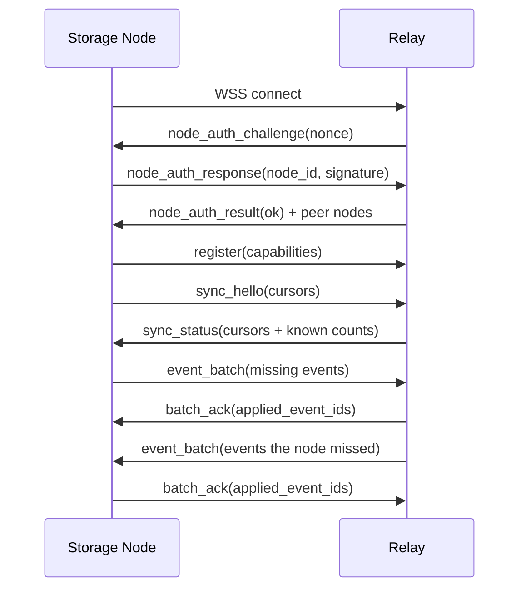

### 9.6 Snapshot protocol

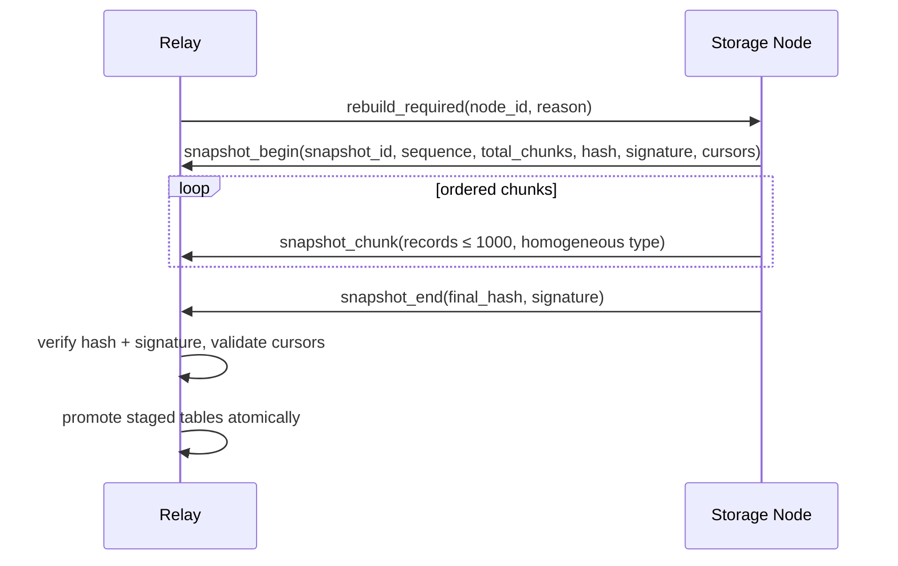

Rules:

- `snapshot_sequence` must be strictly greater than the last promoted sequence;
  otherwise the Relay rejects it as `stale_snapshot`.
- The signature is Ed25519 over the content hash using the node’s trusted public
  key.
- The cursor map is validated against the Relay’s event log (no empty IDs, no
  duplicates, no impossible sequences).
- `snapshot_end` must match `snapshot_begin.content_hash`.
- Promotion is transactional so a duplicate or failed end cannot move state
  backwards.
- A full rebuild includes files/versions, folders, key envelopes, tombstones,
  shard hashes, and activities.

### 9.7 Error model

A generic `error` envelope carries `correlation_id`, `error_code`,
`error_message`, and optional `retryable`.

Codes: `validation_error`, `unknown_message_type`, `incompatible_version`,
`not_found`, `rate_limited`, `internal_error`, `auth_failed`.

Snapshot-specific codes: `stale_snapshot`, `invalid_snapshot_sequence`,
`invalid_cursor_map`, `rebuild_in_progress`.

The `ErrorCode` enum is closed; a Relay test fails if the Relay emits a code not
listed, preventing drift.

### 9.8 HTTP is a first-class part of the protocol

Several operations deliberately bypass the WebSocket envelope:

- Node bootstrap pairing (pairing code redemption).
- Device↔node LAN pairing and challenge-response.
- Path C buffer upload/fetch.
- Browser shard download and node-to-node repair fetch.
- Offline recovery.
- Catalog reads and UI actions.

This keeps large or latency-sensitive payloads out of the JSON message stream
and lets non-browser clients use ordinary HTTP semantics.

---

## 10. Working: End-to-End Flows

### 10.1 Account registration and device enrollment

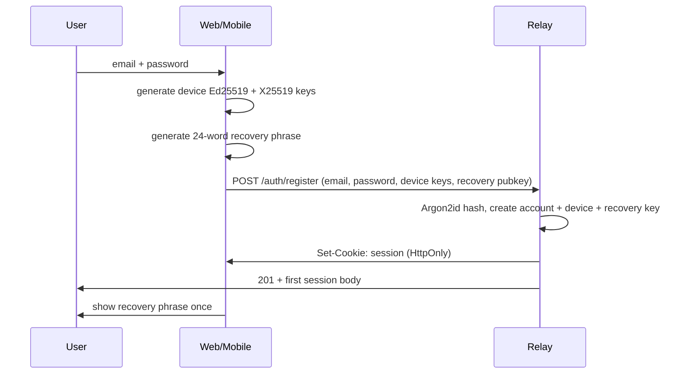

The web BFF sets the cookie; the mobile adapter stores the opaque session token
in SecureStore and sends it as `Authorization: Bearer`. Both map to the same
server-side session model.

### 10.2 Node bootstrap pairing

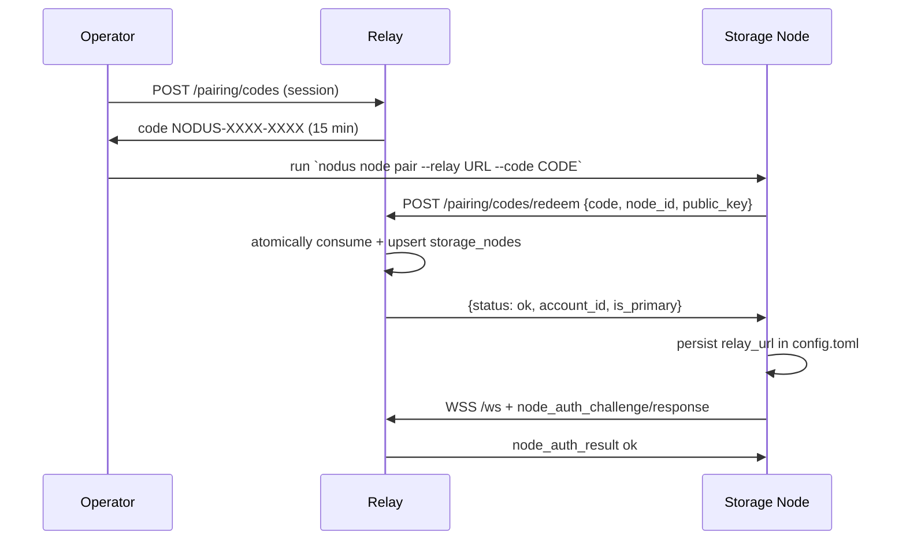

After this, the node is permanently trusted via its Ed25519 identity. The code
is never used again.

### 10.3 Device↔node LAN pairing and authentication

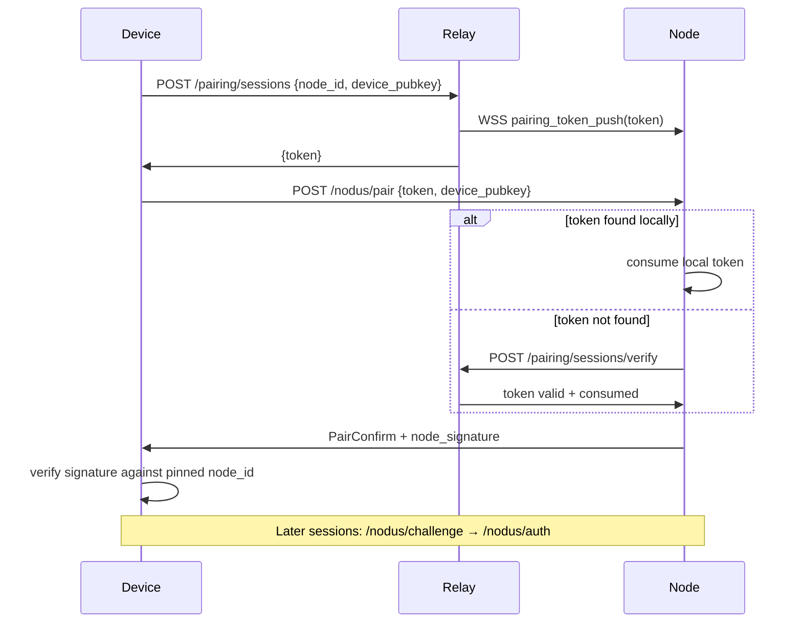

On subsequent connections, the client discovers the node (mDNS or manual IP),
requests a challenge, verifies the node’s signature, signs the nonce, and
authenticates. The IP is only a location, never a trust anchor.

### 10.4 Upload

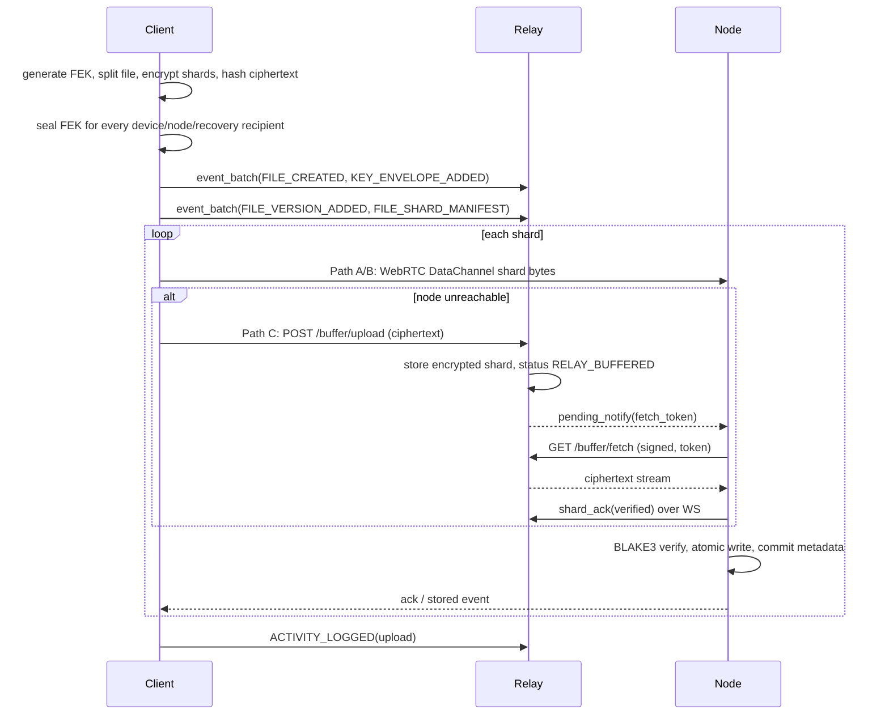

The client publishes metadata before or alongside bytes. The node accepts shards
only if their hash matches the signed manifest (when one is available) and a
paired device is the source.

### 10.5 Download

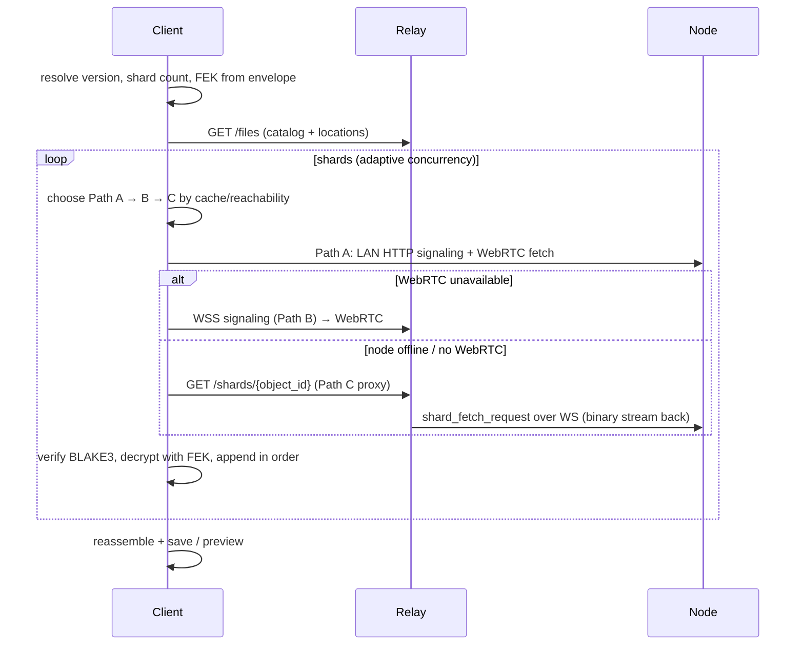

The browser fallback through the Relay preserves the “download works even
without LAN” property. Shard size, hash, and object ID are all checked; a short
read or hash mismatch aborts the shard rather than silently corrupting the file.

### 10.6 Transfer path selection (A → B → C → D)

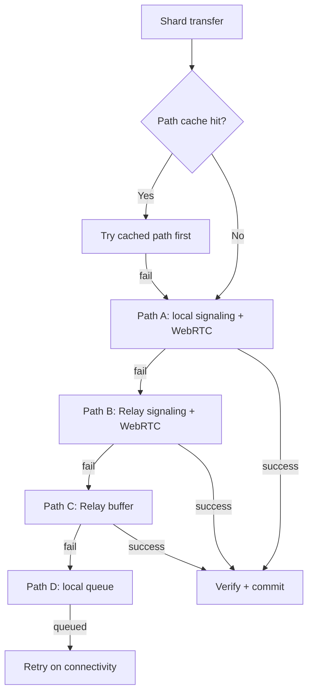

- Path A uses fresh mDNS discovery every attempt; IP addresses are never cached.
- Path B carries only SDP/ICE; file bytes remain peer-to-peer.
- Path C stores encrypted shards on the Relay until the node fetches them.
- Path D persists the transfer locally and retries when the Relay returns.
- Each stage retries with exponential backoff and jitter (base 500 ms, jitter
  300 ms, 2 retries), then falls through.
- A cached path is evicted immediately when it fails.

### 10.7 Incremental synchronization and offline convergence

```mermaid
sequenceDiagram
    participant N as Node
    participant R as Relay
    participant D as Device
    Note over N: offline; user adds file C locally
    N->>N: journal C in sync_outbox
    Note over R,D: Relay online; another device adds D
    D->>R: event_batch(+D)
    N->>R: reconnect + auth + hello(cursors)
    R->>N: status (missing C)
    N->>R: event_batch(+C)
    R->>D: catalog_changed / event batch
    R->>N: event_batch(+D)
    N->>N: apply D idempotently
    Note over N,R,D: final state contains both C and D — no winner
```

There is no database-level conflict resolution. Missing **operations** are
exchanged. Independent additions converge; only concurrent edits to the same
file become a flagged conflict.

### 10.8 Conflict detection and resolution

When a version is added with a parent that already has a different child, the
node/Relay marks the branch as conflicted:

1. A sibling version is assigned a free version number.
2. `conflict_status = flagged`.
3. A conflicted-copy name is computed, e.g.
   `report (conflicted copy, Device B, 2026-09-14).pdf`.
4. Clients show the conflict in a persistent inbox.
5. The user chooses **Keep A**, **Keep B**, or **Keep both**:
   - The choice is stored in `files.preferred_version` (Relay) for A/B.
   - `CONFLICT_RESOLVED` carries an optional `keep_version`.
   - No data is deleted; the choice is reversible.
6. The notice is cleared so a later conflict can alert again.

### 10.9 Delete, restore, and purge

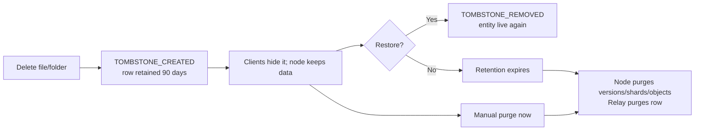

Tombstones prevent a long-offline device from resurrecting deleted data. The
node suppresses projections for tombstoned entities even if an old event
arrives. Purge is explicit or retention-driven and deletes objects only when
unreferenced.

### 10.10 Recovery

**Online (lost password):**

1. Client derives the recovery identity from the 24-word phrase.
2. `POST /auth/recovery/challenge` issues a single-use nonce.
3. `POST /auth/recovery` verifies an Ed25519 signature over the nonce, registers
   the new device, and mints a session.
4. The client opens recovery envelopes, materializes keys locally, and can
   download immediately.

**Offline (no Internet, node on LAN):**

1. Client discovers/authenticates the node.
2. `POST /nodus/recovery/challenge` returns the account ID and recovery public
   key.
3. Client signs the nonce with the recovery key.
4. `POST /nodus/recovery` verifies and registers the new device.
5. `GET /nodus/recovery/envelopes` returns only recovery-recipient envelopes.
6. The client unlocks keys; Relay-backed features wait for Internet.

Recovery never sends the phrase to any server. The account stores only the
recovery public key.

### 10.11 Full Relay rebuild

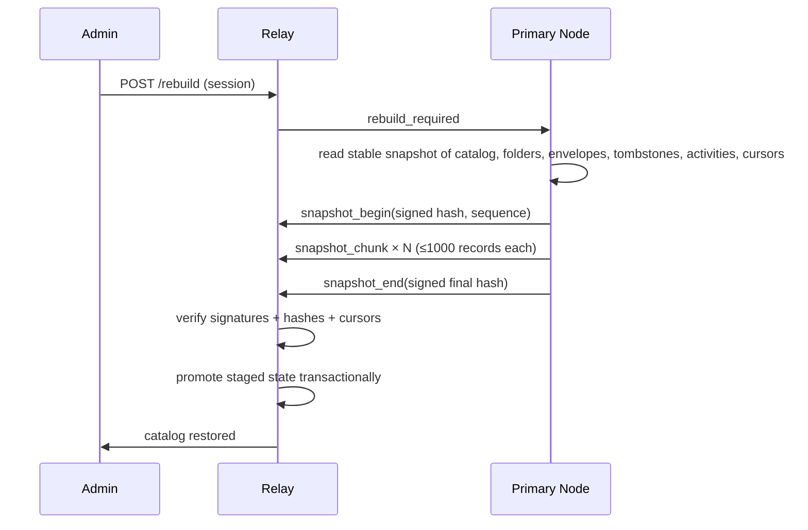

The snapshot is signed by the node and verified against its registered key. A
stale sequence or inconsistent cursor map aborts promotion. This makes the Relay
database a cache of node truth, not an irreplaceable asset.

### 10.12 Reconciliation and repair

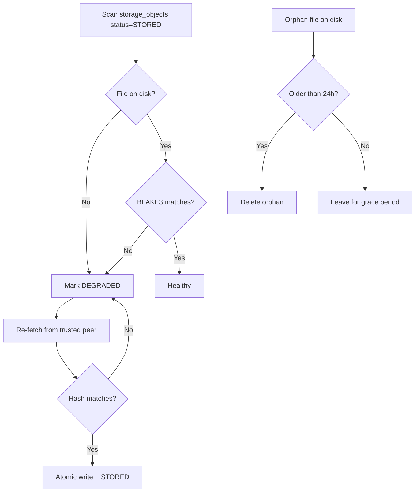

Repair ordering uses the path cache first, then `last_success_at`. A single
best-candidate peer is tried per object in v1; failures retry on the next scan.

### 10.13 Garbage collection

Runs as a background job with a maintenance lock:

1. **Version pruning:** for each file (skipping tombstoned files), keep the 5
   newest versions or any version younger than 30 days, whichever keeps more.
2. **Tombstone purge:** after 90 days, delete the entity’s versions, shards,
   pending fetches, file row, envelopes, and unreferenced objects.
3. **Tombstone compaction:** delete expired tombstone rows.
4. **Orphan sweep:** delete unreferenced object files older than 24 hours.

The refcount check and object delete happen in one conditional SQL statement to
avoid racing a concurrent shard insert.

### 10.14 Notifications

| Event | Channel | Trigger |
|---|---|---|
| Transfer finished | Web local | Client transfer log reaches terminal state |
| Conflict flagged | Relay push / local | `conflict_notices` after an event batch |
| Storage node offline | Relay push | Last WS connection for a node closes |
| Backup complete | Relay push / local | Every shard of a version reaches `NODE_STORED` |

Payloads are generic: file names are encrypted, so notifications never contain a
decrypted name. Per-category opt-outs are honored for Expo and Web Push.

### 10.15 Factory reset

- **Node:** interactive menu or `factory-reset` shell command. Deletes catalogue,
  objects, identity, and config; generates a new node ID; requires re-pairing.
- **Relay:** stop the Relay, run `go run . --factory-reset` (or pipe
  `purge everything`). Deletes the SQLite file and WAL/SHM sidecars, flushes
  Redis, clears the buffer. Guards refuse a relative/root/system/home path and a
  running instance unless forced.

---

## 11. State Machines

### 11.1 Relay shard lifecycle (`file_locations.status`)

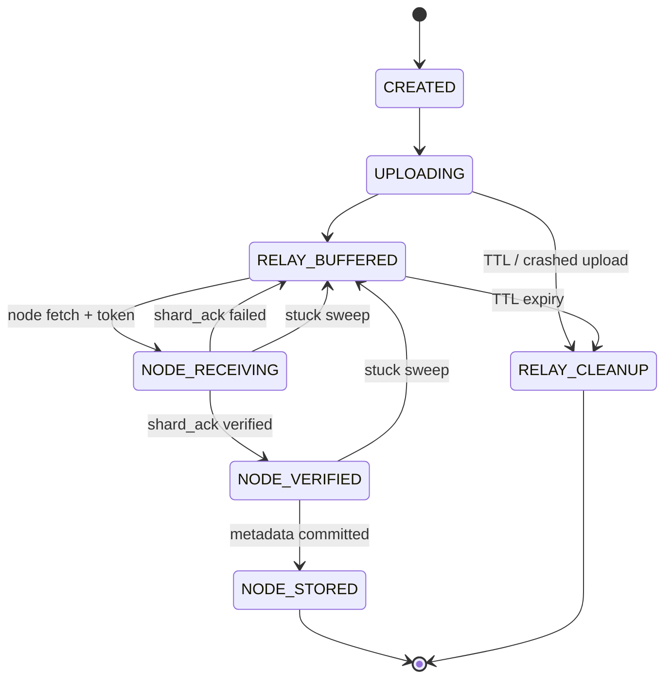

| State | Meaning | Bytes owned by |
|---|---|---|
| `CREATED` | Slot reserved; unused by HTTP upload | — |
| `UPLOADING` | Client mid-upload | Client |
| `RELAY_BUFFERED` | Bytes committed to buffer (`buffer_id` set) | Relay |
| `NODE_RECEIVING` | Node redeemed single-use fetch token | Node (in flight) |
| `NODE_VERIFIED` | Node verified bytes; Relay copy still present | Node |
| `NODE_STORED` | Node owns the shard; buffer cleared/deleted | Node |
| `RELAY_CLEANUP` | Abandoned (TTL, crash, failed pickup) | — |

Invariants:

1. Terminal states are never left.
2. `buffer_id` is set exactly while the Relay owns the bytes.
3. Duplicate/stale acks are rejected; only `NODE_RECEIVING` accepts
   `verified`/`failed`; a token cannot be redeemed twice or by another node.

### 11.2 Per-shard transfer state machine

```text
PENDING ──► ATTEMPTING(path) ──► SUCCEEDED
                  │
                  ├─► retry same path with backoff
                  └─► FAILED_PERMANENT (all paths exhausted)
```

- `PENDING`: not started.
- `ATTEMPTING(path)`: actively trying a specific path.
- `SUCCEEDED`: transferred and verified.
- `FAILED_PERMANENT`: all paths exhausted; requires operator action or new
  information.

### 11.3 Object status (Storage Node)

```text
PENDING ──► STORED ──► DEGRADED ──► STORED (repair)
                         │
                         └─► PERMANENTLY_MISSING (no peer has it)
```

`DEGRADED` triggers repair; `PERMANENTLY_MISSING` is surfaced to the user.

### 11.4 Pairing and session states

| Entity | States |
|---|---|
| Pairing code | `PENDING` → `CONSUMED` (or `REVOKED` reserved) |
| Pairing session | `ACTIVE` → consumed/consumed_at set, or expired |
| Session | active → revoked/logged out, or expired |
| Device | `ACTIVE` → `REVOKED` |
| Node | `ACTIVE` → `REVOKED` (never silently revived) |

### 11.5 File/version model

```text
file_id
├─ version 1
├─ version 2A   (branch, conflict flagged)
└─ version 2B   (branch, conflicted copy name)
```

Versions are immutable. A conflict is a fork, not an overwrite. `preferred_version`
is a user pointer; all branches remain on disk.

---

## 12. Deployment and Operations

### 12.1 Single-origin server unit

The repository ships a complete self-hosted deployment:

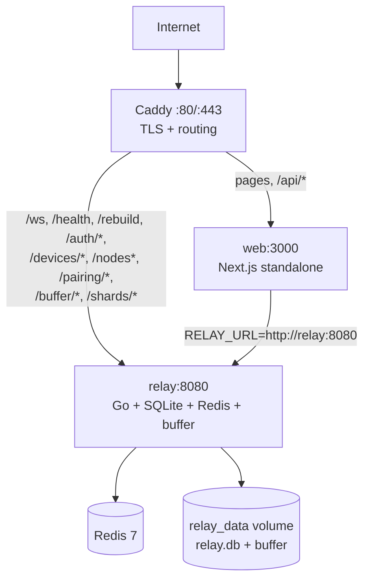

Key deployment facts:

- **One public origin.** The browser only talks to Caddy. Next.js BFF handlers
  call the Relay internally.
- **Caddy** obtains and renews TLS certificates automatically.
- **Relay is single-instance.** SQLite uses a process lock and WAL sidecars.
- **Redis requires a password** in Compose; it holds fetch tokens and auth
  nonces that are credentials.
- **Storage Nodes are separate machines** and must connect through the public
  origin (never `localhost`, Docker service names, or internal addresses).
- `PUBLIC_RELAY_URL` is configured explicitly; it is never inferred from Host
  headers.

### 12.2 Container topology

| Service | Image/build | Depends on | Health check |
|---|---|---|---|
| `redis` | `redis:7-alpine` with `--requirepass` | — | `redis-cli ping` |
| `relay` | `deploy/Dockerfile.relay` | Redis healthy | `/health` returns `"status":"ok"` only if SQLite and Redis answer |
| `web` | `deploy/Dockerfile.web` | Relay healthy | `/api/health` |
| `caddy` | `caddy:2-alpine` | Web + Relay healthy | — |

Volumes: `redis_data`, `relay_data` (database + buffer), `caddy_data`,
`caddy_config`.

### 12.3 Environment variables

#### Relay

| Variable | Default | Purpose |
|---|---|---|
| `PORT` | `8080` | HTTP listen port |
| `DB_PATH` | `${TMPDIR}/nodus-relay/relay.db` | SQLite file |
| `REDIS_URL` | `redis://localhost:6379/0` | Redis DSN |
| `SESSION_COOKIE_NAME` | `nodus_session` | Session cookie name |
| `SESSION_MAX_AGE_DAYS` | `30` | Absolute session lifetime |
| `SESSION_TOUCH_INTERVAL_MINUTES` | `30` | `last_used_at` write throttle |
| `SESSION_COOKIE_SECURE` | `true` | Set `Secure`; false only for local HTTP |
| `ALLOWED_ORIGINS` | localhost spellings | Browser WS origin allowlist |
| `TRUST_PROXY` | `false` | Trust `X-Forwarded-For` from the TLS proxy |
| `BUFFER_DIR` | `${TMPDIR}/nodus-relay/buffer` | Encrypted shard buffer |
| `BUFFER_TTL_HOURS` | `72` | Buffered shard lease |
| `MAX_SHARD_BYTES_MB` | `32` | Per-shard cap |
| `EXPO_PUSH_ACCESS_TOKEN` | empty | Expo push credential |
| `VAPID_PUBLIC_KEY` / `VAPID_PRIVATE_KEY` | empty | Web Push credentials |
| `VAPID_SUBJECT` | `mailto:admin@example.com` | VAPID subject |

#### Web

| Variable | Purpose |
|---|---|
| `RELAY_URL` | Internal Relay base for server-side BFF handlers (e.g. `http://relay:8080`) |
| `PUBLIC_RELAY_URL` | User-facing origin shown in pairing instructions |
| `NEXT_PUBLIC_RELAY_URL` | Optional split-deployment browser WS origin; unset in production |
| `NEXT_PUBLIC_VAPID_PUBLIC_KEY` | Browser push public key |

#### Storage Node

| Variable / flag | Purpose |
|---|---|
| `--data-dir PATH` / `NODUS_DATA_DIR` | Data directory |
| `--force-adopt` | Adopt an existing data directory without prompting |
| `--relay URL` | Relay origin (highest precedence) |
| `config.toml relay_url` | Persisted after successful pairing |
| `NODUS_RELAY_URL` | Fallback Relay origin |
| `--code CODE` | Pairing code for `nodus node pair` |

### 12.4 Production checklist

1. Point a DNS record at the server.
2. Set `SITE_ADDRESS`, `PUBLIC_RELAY_URL`, `ALLOWED_ORIGINS`,
   `SESSION_COOKIE_SECURE=true`, and a strong URL-safe `REDIS_PASSWORD`.
3. `docker compose --env-file deploy/.env up --build -d`.
4. Verify `/health` reports both SQLite and Redis healthy.
5. Register an account, add a Storage Node, run the printed pairing command on
   the node machine.
6. Configure push credentials if notifications are wanted.

### 12.5 Backup and restore

- **Relay:** the `relay_data` volume holds `relay.db` and WAL sidecars. Use
  `VACUUM INTO`, the SQLite backup API, or Litestream. Never `cp` a live
  database. To restore, stop the Relay, replace the file (remove `-wal`/`-shm`),
  and start again. If lost, rebuild from a node snapshot.
- **Storage Node:** back up `nodus.db`, `objects/`, and `~/.nodus/identity/`.
  Without the identity, the node cannot authenticate; without the objects, the
  catalogue references missing data (reconciliation will mark it `DEGRADED`).
- **Clients:** not required for durability; keys can be re-derived from the
  recovery phrase and envelopes.

### 12.6 Operational constraints

- Run exactly **one Relay replica**.
- On Unix, the database lock prevents a second instance and lets factory reset
  refuse to delete a live database.
- Local filesystem only for SQLite (WAL sidecars do not work on NFS/SMB).
- Buffer directory must be a dedicated path; factory reset refuses dangerous
  values.
- Storage Node and Relay clocks should be reasonably synchronized (signed
  requests use ±60-second freshness).

---

## 13. Testing and Validation

### 13.1 Test commands

```bash
pnpm test          # TypeScript, Go, Rust
pnpm --filter web test
go -C services/relay test ./...
cargo test --manifest-path services/storage-node/Cargo.toml
```

Redis-dependent Relay tests skip unless `TEST_REDIS_URL` is set. Each Go test
uses its own SQLite database file, so no database service is required.

### 13.2 Test coverage by layer

| Layer | Tests |
|---|---|
| `packages/core` | Sharding edge cases (0-byte, gaps, duplicates), AES-GCM round trips, tamper detection, envelopes, recovery derivation |
| `packages/protocol` | Schema validation, version compatibility, error codes, generated schema manifest |
| `packages/sdk` | Auth, device identity, catalog, conflicts, envelopes, folders, recovery, uploader, adaptive download, WebCrypto signer |
| `packages/relay-client` | Discovery, node URL normalization, signed requests |
| `packages/transfer-manager` | Path fallback, cache eviction, backoff, concurrency |
| `apps/web` | BFF routes, device registration, pairing codes, tombstones, push, download helpers, conflict UI |
| `apps/mobile` | At-rest storage, discovery, Relay URL validation, file/activity views, filename/metrics helpers |
| `services/relay` | Auth, sessions, pairing, device/node registration, sync batches, buffer upload/fetch/load, rebuild, snapshots, conflicts, tombstones, rate limits, WS origin/cookie, push, reset guardrails |
| `services/storage-node` | Local auth/pairing/recovery, shard fetch, WebRTC transfer/session/outbound, offline divergence, object store, GC, reconciliation |

### 13.3 Phase 18 validation matrix

| Scenario | Evidence |
|---|---|
| Internet unavailable; client↔node works | Rust WebRTC session transfer test with no Relay; Path A branch in SDK; LAN fetch in relay-client |
| Relay database loss → rebuild | Go rebuild/snapshot integration tests; envelope/folder staging assertions |
| Node offline → reconnect → convergence | Rust `offline_divergence_test`; Go sync integration tests |
| Concurrent edits → conflicted copies | Go conflict integration tests; web/mobile conflict UI tests |
| Disk corruption / missing objects → repair | Rust reconciliation/GC tests; node repair attempter tests |
| Sustained Path C load | Go `TestBufferUploadSustainedLoad` (50 concurrent shards) |
| Relay sees no plaintext; revocation removes access | `docs/security/phase18-review.md` + buffer/envelope/revocation code |

### 13.4 End-to-end harnesses

- `scripts/e2e-bootstrap-pairing.sh` — account creation, pairing code, node
  registration, SQLite assertions.
- `scripts/e2e-path-c.sh` — buffer upload/fetch and cleanup.
- `scripts/benchmark-webrtc` — WebRTC negotiation timing used to tune the 4-second
  timeout.
- GitHub Actions: CI for TypeScript/Go/Rust, plus an E2E workflow that injects
  push credentials from secrets into `deploy/.env`.

### 13.5 Known validation gaps

- The Path C load test is a correctness smoke test, not a capacity benchmark
  (a `BenchmarkBufferUpload` exists for numbers).
- The “Internet unavailable” coverage is transport-level; a full UI rehearsal
  with the router down is not automated.
- No signed mobile binaries in CI (only typecheck, JS tests, `expo prebuild` /
  `expo export`).

---

## 14. Current Status, Limitations, and Future Work

### 14.1 Implemented

- Design foundations: five ADRs plus follow-ups for identity, recovery,
  conflicts, mobile discovery, GC, bootstrap pairing, native SDK, and
  non-extractable keys.
- Protocol package with zod validation, JSON Schema generation, and version 1.8.
- Rust Storage Node: SQLite schema, object store, crash recovery, sync, snapshot,
  WebRTC, local auth/pairing/recovery, transfer manager, GC, reconciliation,
  repair.
- Go Relay: accounts/sessions/devices/nodes, pairing, catalog, envelopes,
  activities, tombstones, sync, buffer, WebRTC signaling, rebuild, push,
  notifications, factory reset.
- Web client: design system port, auth, dashboard routes, catalog, upload,
  download, pairing, conflicts, tombstones, security, settings, push, recovery.
- Mobile client: native build, five-tab navigation, auth, pairing, mDNS,
  Path A/B/C/D, upload/download, folders, devices/nodes, recovery, background
  drain, runtime Relay selection.
- Deployment unit: Docker Compose + Caddy + SQLite/Redis, health checks, E2E
  scripts.

### 14.2 Limitations

| Area | Limitation |
|---|---|
| Relay scaling | Single instance only (SQLite file lock) |
| LAN transport | Plain HTTP; no TLS on the local listener |
| Mobile background | Path A discovery/transfer foreground-only |
| Key rotation | Node identity immutable; no routine re-pairing/rotation |
| Conflict merge | No content-aware merge; preserve-both + user choice |
| Recovery phrase | User responsibility; stored locally on trusted devices |
| Path B/C | Relay is still a dependency for cross-network sync |
| Rebuild | `preferred_version` is not recovered from a node snapshot (tracked follow-up) |
| Offline first pairing | Requires the node to reach the Relay or have a local token |
| Browser LAN | HTTPS pages cannot call `http://<LAN-node>:9378` (mixed content), so production TLS LAN is out of v1 scope |
| Mobile Relay URL | Cleartext Relay URLs are rejected except loopback/emulator |

### 14.3 Future work

- TLS or Noise for the LAN listener if untrusted networks become in scope.
- Background local sync on mobile.
- QR pairing reusing the existing code redemption.
- Key rotation / re-pairing flow.
- Content-aware conflict merge for text files.
- Multi-node replication/failover and a multi-writer Relay store.
- Per-account GC policy configuration.
- Relay-side deduplication/metrics and capacity benchmarking.
- Signed recovery challenges from the node (noted audit follow-up).

### 14.4 Measured performance (2026-10-22)

A separate [PERFORMANCE_REPORT.md](./PERFORMANCE_REPORT.md) records reproducible
measurements on an Intel i5-11400H / 12-thread machine:

- Client crypto pipeline: **~27 MiB/s upload**, **~55 MiB/s download** for a
  64 MiB file split into 8 MiB shards (pure-JS AES-GCM + BLAKE3).
- Sharding: **~5 GiB/s**; filename crypto: **>50k ops/s**; FEK envelope seal:
  **~1.4–1.7 ms/recipient**.
- Relay Path C handler: **~0.86 GB/s** for 8 MiB shards on tmpfs, excluding
  network/TLS/disk.
- Release artifacts: Relay **14 MB** / **96 ms** startup; Storage Node **23 MB**
  / **26 ms** startup.
- Full suite: **96.5 s**, 654 TypeScript + 482 Rust + 278 Go test functions, all
  passing.

The measured ceiling is client-side crypto, not the Relay; hardware WebCrypto,
WASM BLAKE3, and worker-based shard parallelism are the recommended next wins.

---

## 15. Glossary

| Term | Definition |
|---|---|
| **ADR** | Architecture Decision Record under `docs/decisions/` |
| **Argon2id** | Password hashing function used by the Relay |
| **BLAKE3** | Cryptographic hash used for content addressing and integrity |
| **BFF** | Backend-for-Frontend; Next.js route handlers proxying the Relay |
| **CNG** | Continuous Native Generation (Expo native build) |
| **CRDT** | Conflict-free replicated data type (not used; versions + conflicts instead) |
| **FEK** | File Encryption Key |
| **GCM** | Galois/Counter Mode (authenticated encryption) |
| **mDNS** | Multicast DNS; used to discover `_nodus._tcp` nodes on the LAN |
| **Object** | Content-addressed encrypted shard blob |
| **Path A/B/C/D** | Transfer fallback strategies |
| **Snapshot** | Signed metadata export used to rebuild the Relay |
| **Tombstone** | Soft-delete marker preventing resurrection |
| **WAL** | SQLite write-ahead log |

---

## 16. References

### Primary project documents

- `README.md` — overview, status, setup, tests, factory reset.
- `nodus_implementation_plan.md` — full original design (note: some PostgreSQL
  references are legacy; the Relay ships with SQLite).
- `Todo.md` — phase-by-phase implementation checklist.

### Architecture

- `docs/architecture/README.md`
- `docs/architecture/file-state-machine.md`
- `docs/architecture/transfer-manager-spec.md`
- `docs/architecture/phase18-validation.md`

### Decisions (ADRs)

- `docs/decisions/0001-key-hierarchy.md` — X25519, Ed25519→X25519 derivation,
  revocation semantics.
- `docs/decisions/0002-recovery-mechanism.md` — BIP39 phrase, online/offline
  recovery, recovery envelopes.
- `docs/decisions/0003-conflict-resolution-ux.md` — conflicted-copy inbox and
  `preferred_version`.
- `docs/decisions/0004-mobile-local-discovery.md` — Expo CNG, foreground-only
  Path A.
- `docs/decisions/0005-garbage-collection-policy.md` — retention defaults.
- `docs/decisions/0006-self-hosted-node-bootstrap-pairing.md` — pairing codes.
- `docs/decisions/0007-mobile-native-and-sdk.md` — native build and shared SDK.
- `docs/decisions/0008-non-extractable-device-keys.md` — separate signing and
  encryption keys.

### Protocol

- `docs/protocol/README.md`
- `docs/protocol/message-catalog.md`
- `docs/protocol/event-types.md`
- `docs/protocol/schema-versioning.md`
- `docs/protocol/local-discovery.md`

### Security

- `docs/security/README.md`
- `docs/security/bootstrap-pairing.md`
- `docs/security/local-endpoints.md`
- `docs/security/phase18-review.md`
- `docs/push-notifications.md`

### Source of truth in code

- Relay routes and schema: `services/relay/main.go`,
  `services/relay/internal/db/sqlite_migrations/0001_baseline.up.sql`
- Node schema: `services/storage-node/migrations/*.sql`
- Wire schemas: `packages/protocol/src/`
- Crypto/sharding: `packages/core/src/`
- Transfer logic: `packages/transfer-manager/src/`,
  `services/storage-node/src/transfer/`
- Sync/snapshot: `services/storage-node/src/sync/`
- Deployment: `deploy/`

---

## Appendix A — Relay HTTP API

### Authentication and recovery

| Method | Path | Auth | Purpose |
|---|---|---|---|
| `POST` | `/auth/register` | Open | Create account + device + recovery key |
| `POST` | `/auth/login` | Open | Password login, mint session |
| `GET` | `/auth/session` | Session | Current session/account/device |
| `POST` | `/auth/logout` | Session | Invalidate current session |
| `POST` | `/auth/password` | Session | Change password, rotate sessions |
| `POST` | `/auth/logout-all` | Session | Revoke all sessions except current |
| `POST` | `/auth/recovery/challenge` | Open | Issue recovery nonce |
| `POST` | `/auth/recovery` | Open (signed) | Verify recovery signature, mint session |
| `PUT` | `/account/recovery` | Session | Enroll/rotate recovery public key |

### Devices, nodes, and push

| Method | Path | Auth | Purpose |
|---|---|---|---|
| `POST` | `/devices/register` | Session | Register device key |
| `GET` | `/devices` | Session | List devices |
| `DELETE` | `/devices/{id}` | Session | Revoke device |
| `PATCH` | `/devices/{id}` | Session | Rename device |
| `POST` | `/devices/push-token` | Session | Register Expo token |
| `DELETE` | `/devices/push-token` | Session | Remove Expo token |
| `POST` | `/devices/web-push` | Session | Register browser push |
| `DELETE` | `/devices/web-push` | Session | Remove browser push |
| `POST` | `/nodes/register` | Session | Register node |
| `GET` | `/nodes` | Session | List nodes |
| `PATCH` | `/nodes/{node_id}` | Session | Rename node |
| `POST` | `/nodes/{node_id}/ping` | Session | Probe node over WS |
| `POST` | `/devices/{device_id}/ping` | Session | Probe device over WS |

### Pairing

| Method | Path | Auth | Purpose |
|---|---|---|---|
| `POST` | `/pairing/codes` | Session | Mint `NODUS-XXXX-XXXX` |
| `POST` | `/pairing/codes/redeem` | Open | Redeem node bootstrap code |
| `POST` | `/pairing/sessions` | Session | Mint device-bound token |
| `POST` | `/pairing/sessions/verify` | Open | Node verifies/redeems token |
| `GET` | `/nodes/verify` | Open | Verify node URL |

### Catalog and metadata

| Method | Path | Auth | Purpose |
|---|---|---|---|
| `GET` | `/files` | Session | File catalog |
| `GET` | `/folders` | Session | Folder catalog |
| `GET` | `/activities` | Session | Activity feed |
| `GET` | `/envelopes` | Session | Key envelopes |
| `GET` | `/envelopes/summary` | Session | Coverage counts |
| `GET` | `/envelopes/export` | Session | Ciphertext-only export |
| `GET` | `/folder-envelopes` | Session | Bulk folder envelopes |
| `GET` | `/tombstones` | Session | Deleted items |
| `DELETE` | `/tombstones/{type}/{id}` | Session | Purge now |
| `POST` | `/tombstones/{type}/{id}/restore` | Session | Restore |
| `POST` | `/files/{file_id}/conflicts/resolve` | Session | Choose version |

### Transfers and rebuild

| Method | Path | Auth | Purpose |
|---|---|---|---|
| `POST` | `/buffer/upload` | Session | Path C shard upload |
| `GET` | `/buffer/fetch` | Node signature + token | Node fetches buffered shard |
| `GET` | `/shards/{object_id}` | Session | Browser shard download fallback |
| `GET` | `/node/shards/{object_id}` | Node signature | Peer repair fetch |
| `POST` | `/rebuild` | Session | Request full snapshot rebuild |
| `GET` | `/health` | Open | SQLite + Redis health |
| `GET` | `/ws` | Cookie or node auth | WebSocket gateway |

The web app exposes same-origin `/api/*` equivalents for browser use; native
clients call the Relay paths directly with a bearer session where applicable.

---

## Appendix B — Storage Node Local HTTP API

Base: `http://<node-host>:9378` (advertised via mDNS `_nodus._tcp.local`).

| Method | Path | Auth | Purpose |
|---|---|---|---|
| `GET` | `/nodus/discovery` | None | `{node_id, public_key, schema_version, pk_fp}` |
| `POST` | `/nodus/challenge` | None | Single-use nonce + signed node identity |
| `POST` | `/nodus/auth` | Device signature | Authenticate a paired device |
| `POST` | `/nodus/pair` | Pairing token | Redeem Relay-issued device token |
| `POST` | `/nodus/recovery/challenge` | None | Offline recovery nonce + account ID |
| `POST` | `/nodus/recovery` | Recovery signature | Register new device offline |
| `GET` | `/nodus/recovery/envelopes` | Signed device request | Recovery-recipient envelopes |
| `GET` | `/nodus/activities` | Signed device request | LAN activity feed |
| `GET` | `/nodus/shard/{object_id}` | Node signature | Node-to-node repair fetch |
| `POST` | `/nodus/webrtc/offer` | Signed device headers | Create WebRTC session, return signed SDP answer |
| `POST` | `/nodus/webrtc/ice` | Signed device headers | Trickle ICE candidate |
| `GET` | `/nodus/webrtc/ice-candidates` | Signed device headers | SSE stream of ICE candidates |

CORS is permissive on this listener; authentication is the challenge-response
handshake, not the origin.

---

## Appendix C — WebSocket and Event Reference

### Control and presence

| Message | Direction | Purpose |
|---|---|---|
| `register` | Peer → Relay | Announce identity/capabilities |
| `heartbeat` | Peer → Relay | Presence |
| `node_auth_challenge` | Relay → Node | Nonce |
| `node_auth_response` | Node → Relay | Signed nonce |
| `node_auth_result` | Relay → Node | ok/fail with reason |
| `ping` / `pong` | Both | Manual reachability probe |
| `presence_query` / `presence_result` | Relay ↔ Peer | Presence lookup |

### Signaling and transfer

| Message | Direction | Purpose |
|---|---|---|
| `webrtc_offer` / `webrtc_answer` / `webrtc_ice_candidate` | Relay ↔ Peer | Path B signaling only |
| `shard_upload` | Client → Node | Shard metadata (bytes separate) |
| `shard_ack` | Node → Relay | received/verified/failed |
| `pending_notify` | Relay → Node | Buffered shard + fetch token |
| `shard_fetch` | Peer → Peer | Fetch request metadata |
| `shard_fetch_request` / `shard_fetch_result` / `shard_fetch_done` | Relay ↔ Node | Binary shard streaming |
| `shard_delete` | Relay → Node | Delete shard |
| `tombstone_ack` | Node → Relay | Per-node delete/purge progress |
| `purge_tombstone` / `restore_tombstone` | Relay → Node | Purge/restore command |

### Sync and snapshot

| Message | Direction | Purpose |
|---|---|---|
| `sync_hello` / `sync_status` | Both | Cursor exchange |
| `event_batch` | Both | Ordered events |
| `batch_ack` | Both | Applied IDs / rejection reason |
| `reconcile` | Both | Physical reconciliation signal |
| `snapshot_begin` / `snapshot_chunk` / `snapshot_end` | Node → Relay | Full rebuild |
| `rebuild_required` | Relay → Node | Trigger a rebuild |
| `error` | Both | Structured error |
| `catalog_changed` | Relay → Client | Catalog invalidation signal |

### Event payload essentials

| Event | Required fields |
|---|---|
| `FILE_CREATED` / `FILE_DELETED` | `file_id`; optional parent, encrypted name, content hash |
| `FILE_VERSION_ADDED` / `FILE_MODIFIED` | `file_id`, `version_number`, `shard_count`, `version_hash` |
| `FILE_SHARD_MANIFEST` | `file_id`, `version_number`, `shard_hashes`, `signature` |
| `DEVICE_REVOKED` | `device_id`, `revoked_at` |
| `TOMBSTONE_CREATED` | `entity_type`, `entity_id`, `deleted_at` |
| `TOMBSTONE_REMOVED` | `entity_type`, `entity_id` |
| `FOLDER_CREATED` / `FOLDER_DELETED` | `folder_id`; optional parent/name |
| `KEY_ENVELOPE_ADDED` | `file_id`, `recipient_id`, `recipient_kind`, `encrypted_key` |
| `FOLDER_KEY_ENVELOPE_ADDED` | `folder_id`, `recipient_id`, `recipient_kind`, `encrypted_key` |
| `CONFLICT_RESOLVED` | file/version identifiers + optional `keep_version` |
| `ACTIVITY_LOGGED` | `activity_id`, `kind`, `outcome`, `created_at`; optional file/path/detail |

---

## Appendix D — Configuration Reference

### Storage Node files

```text
~/.nodus/                     # fixed config dir
├─ identity/
│  ├─ node_private_key        # Ed25519 seed (zeroized on read)
│  └─ node_id                 # hex public key
├─ config.toml                # data_dir; relay_url after pairing
└─ migration.json             # data-dir move journal (if used)

<data_dir>/
├─ nodus.db
├─ objects/<prefix>/<hash>
├─ temp/
└─ logs/
```

### Relay data

```text
<DB_PATH>                     # relay.db (SQLite, WAL)
<DB_PATH>-wal / -shm          # SQLite sidecars (must stay beside the DB)
<DB_PATH>.lock                # exclusive process lock
<BUFFER_DIR>/                 # encrypted shard buffer (0700/0600)
```

### Key protocol constants

| Constant | Value |
|---|---|
| Default shard size | 8 MiB |
| Min / max shard size | 1 MiB / 32 MiB |
| AES-GCM nonce | 12 bytes |
| FEK | 32 bytes |
| BLAKE3 digest | 32 bytes (64 hex chars) |
| Local discovery port | 9378 |
| mDNS service | `_nodus._tcp.local` |
| Challenge nonce TTL | 30 s |
| Pairing code TTL | 15 min |
| Pairing token TTL | 15 min |
| Session lifetime | 30 days |
| Buffer TTL | 72 h |
| Tombstone retention | 90 days |
| Orphan grace | 24 h |
| GC version rule | 5 newest or < 30 days |
| Snapshot chunk records | 1000 |
| Transfer concurrency | 4 |
| WebRTC negotiation timeout | 4 s |
| mDNS discovery timeout | 2 s |
| Relay signaling timeout | 3 s |
| Backoff | 500 ms base, 300 ms jitter, 2 retries |

---

## Appendix E — Presentation Notes

### Suggested slide sequence (12–15 slides)

1. **Title** — Nodus: offline-first P2P storage.
2. **Problem** — cloud dependency, provider-held keys, last-write-wins.
3. **Solution** — four components, Internet as enhancement.
4. **Architecture diagram** — clients, Relay, Storage Node, LAN/Internet.
5. **Control plane vs storage plane** — who owns what.
6. **Encryption pipeline** — shard → AES-GCM → BLAKE3 → envelopes.
7. **Four transfer paths** — A/B/C/D with one-line trade-offs.
8. **Sync model** — events, cursors, offline convergence example.
9. **Conflict handling** — immutable versions, conflicted copies, Keep A/B/Both.
10. **Recovery and rebuild** — BIP39 phrase, offline recovery, signed snapshot.
11. **Database design** — three stores + ER overview.
12. **Security model** — identities, sessions, pairing, threat mitigations.
13. **Deployment** — single origin, Caddy, Compose, SQLite/Redis.
14. **Validation** — Phase 18 matrix and test layers.
15. **Limitations and roadmap** — honest scope boundaries.

### Key talking points

- **“The Internet is an enhancement, not a dependency.”** Everything else follows
  from this principle.
- **The Relay is not trusted with secrets.** It routes, authenticates, and
  buffers ciphertext; it cannot read files or keys.
- **The node is authoritative for its data.** The Relay is rebuildable.
- **Operations, not snapshots, are synchronized.** This is what makes offline
  convergence possible.
- **Conflicts preserve both sides.** No silent data loss.
- **Four paths make transfer resilient.** Direct LAN, Relay signaling, buffered
  delivery, or local queue.
- **The design is deliberately honest about v1 limits:** single Relay, plain LAN
  transport, no content merge, immutable node identity.

### One-paragraph abstract

> Nodus is a hybrid, offline-first peer-to-peer storage system that keeps file
> data on a user-controlled Rust Storage Node while using a self-hosted Go Relay
> for authentication, signaling, synchronization, and temporary encrypted
> buffering. Files are sharded, encrypted client-side with AES-256-GCM, and
> content-addressed with BLAKE3; per-file keys are distributed as X25519 sealed
> envelopes so servers never see plaintext. A Next.js web client and an Expo
> React Native mobile client share a TypeScript SDK and synchronize through
> immutable events with per-origin cursors. Transfers fall back across direct
> LAN WebRTC, Relay signaling, Relay buffering, and a local queue, while a signed
> snapshot protocol allows the Relay’s SQLite metadata to be rebuilt from a
> Storage Node. The result is a storage system that works offline, preserves both
> sides of conflicts, and treats the Internet as an enhancement rather than a
> dependency.
